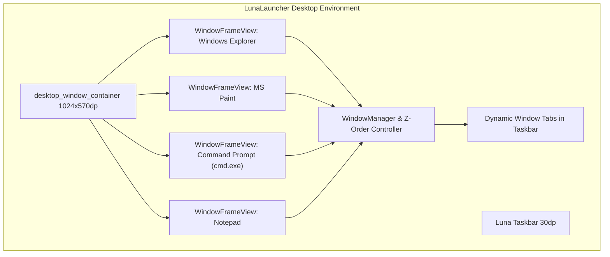

# Windows XP Windowed Desktop Manager, Authentic Icons & DOSBox Implementation Plan

> **For agentic workers:** REQUIRED SUB-SKILL: Use superpowers:subagent-driven-development to implement this plan task-by-task. Steps use checkbox (`- [ ]`) syntax for tracking.

**Goal:** Transform `LunaLauncher` into a true multi-window desktop OS environment with movable, resizable, floating native apps, authentic Windows XP 32-bit icons, and a dual-mode Command Prompt / DOSBox console.

**Architecture:** `LunaLauncher` hosts a `1024x570dp` desktop canvas above the 30dp Luna Taskbar. Applications (Notepad, Paint, Windows Explorer, Command Prompt, Media Player, Games) open as floating `WindowFrameView` instances with authentic title bars, minimize/maximize/restore/close controls, drag-to-move, and active/inactive z-ordering. An authentic `cmd.exe` console provides classic DOS commands, Linux shell bridging, and DOSBox integration.

**Architecture Diagram:**



**Tech Stack:** Android KitKat SDK (API 19), Java 7, AOSP View Framework, Custom Touch Event Dispatcher, Android Runtime Shell Process Execution, Aapt & D8 build toolchain, WSL2 Ubuntu.

## Global Constraints
- Target Hardware: Samsung Galaxy Tab 3 7.0 (SM-T210 / SM-T210R, `lt02wifi`, Marvell PXA986 dual-core, Vivante GC1000 GPU, 1024x600 landscape).
- Android API Level: 19 (Android 4.4.2 KitKat).
- Zero external heavy dependencies (clean vanilla Android View subclasses for high performance on 1 GB RAM).
- Absolute clamping: Windows cannot be dragged off-screen or below the 30dp taskbar.

---

### Task 1: Authentic Windows XP Icon Extraction & Resource Scaffolding

**Files:**
- Create: `tools/fetch_authentic_xp_icons.py`
- Modify: `apps/LunaLauncher/res/values/colors.xml`
- Create: `apps/LunaLauncher/res/drawable/luna_titlebar_active.xml`
- Create: `apps/LunaLauncher/res/drawable/luna_titlebar_inactive.xml`
- Create: `apps/LunaLauncher/res/drawable/window_frame_border.xml`
- Create: `apps/LunaLauncher/res/drawable/btn_restore.png`
- Test: Verify all icon PNGs exist and have valid dimensions (48x48, 32x32, 16x16)

**Interfaces:**
- Produces: Authentic icon drawables (`ic_my_computer`, `ic_my_documents`, `ic_cmd`, `ic_notepad`, `ic_paint`, `ic_drive_c`, `ic_drive_d`, `ic_folder`, `ic_ie`, `ic_wmp`, `ic_minesweeper`, `ic_solitaire`, `ic_recycle_bin`, `ic_control_panel`), control button drawables (`btn_min`, `btn_max`, `btn_restore`, `btn_close`), and window frame background XMLs.

- [ ] **Step 1: Write python script to fetch & extract authentic Windows XP icons**
Create `tools/fetch_authentic_xp_icons.py` targeting `wieslawsoltes/WinXp` and `bartekl1/windows-ui-assets` raw assets, converting to RGBA PNG and saving to `apps/LunaLauncher/res/drawable/` and `apps/WindowsExplorer/res/drawable/`.

- [ ] **Step 2: Run script to generate & download authentic icons**
Run: `python tools/fetch_authentic_xp_icons.py`
Expected: Download and verify all 18+ high-fidelity icon drawables.

- [ ] **Step 3: Create window frame drawables and style resources**
Create `luna_titlebar_active.xml` (gradient `#0055EA` to `#00138C`), `luna_titlebar_inactive.xml` (gradient `#7A96DF` to `#5A70B2`), `window_frame_border.xml` (3px border), and `btn_restore.png`.

- [ ] **Step 4: Verify resource integrity**
Run: Verify image headers and XML validity with Python/aapt.

- [ ] **Step 5: Commit**
Run: `git add tools/fetch_authentic_xp_icons.py apps/LunaLauncher/res/ apps/WindowsExplorer/res/ && git commit -m "feat(assets): extract authentic Windows XP 32-bit icons and window frame resources"`

---

### Task 2: Multi-Window Framework (`WindowFrameView`) in LunaLauncher

**Files:**
- Create: `apps/LunaLauncher/src/com/windows/xp/launcher/window/WindowFrameView.java`
- Modify: `apps/LunaLauncher/res/layout/activity_launcher.xml`
- Modify: `apps/LunaLauncher/src/com/windows/xp/launcher/LauncherActivity.java`

**Interfaces:**
- Consumes: Authentic drawables and layout container.
- Produces: `WindowFrameView` class with methods `setTitle(String)`, `setIcon(int)`, `setContentView(View)`, `minimize()`, `maximize()`, `restore()`, `close()`, `bringToFront()`.

- [ ] **Step 1: Implement `WindowFrameView.java`**
Implement the floating window frame:
  - Header with title icon, bold title text, Minimize (`_`), Maximize/Restore (`□` / `❐`), and Close (`X`).
  - Touch listener on title bar for drag-to-move with coordinate clamping `[0 <= X <= 1024 - width]` and `[0 <= Y <= 570 - height]`.
  - Maximize toggling between stored floating bounds and full screen `1024x570dp`.
  - Minimize hiding window and notifying parent launcher.
  - Active/Inactive visual state updates on touch focus.
  - Corner resize handle for dragging to change window size.

- [ ] **Step 2: Update `activity_launcher.xml` with desktop window container**
Add `FrameLayout android:id="@+id/desktop_window_container"` spanning `1024x570dp` directly above the 30dp taskbar.

- [ ] **Step 3: Update `LauncherActivity.java` window management**
Add window tracking:
  - `addWindow(WindowFrameView window, String title, int iconRes)`
  - `activateWindow(WindowFrameView window)`
  - Synchronize active/inactive state with taskbar tabs in `taskbarTabsContainer`.
  - Clicking a taskbar tab toggles minimize / restore and raises z-order.

- [ ] **Step 4: Compile and test window frame scaffolding**
Verify compilation with `tools/build_apk.sh LunaLauncher`.

- [ ] **Step 5: Commit**
Run: `git add apps/LunaLauncher/ && git commit -m "feat(launcher): implement WindowFrameView floating window manager"`

---

### Task 3: Dual-Mode Windows XP Command Prompt & DOSBox (`CmdPromptView`)

**Files:**
- Create: `apps/LunaLauncher/src/com/windows/xp/launcher/window/CmdPromptView.java`
- Create: `apps/LunaLauncher/res/layout/view_cmd_prompt.xml`
- Modify: `apps/LunaLauncher/src/com/windows/xp/launcher/LauncherActivity.java`

**Interfaces:**
- Consumes: `WindowFrameView`.
- Produces: `CmdPromptView` console with command processing engine.

- [ ] **Step 1: Create layout `view_cmd_prompt.xml`**
Monospace terminal layout: pure black background `#000000`, green/white monospace font, scrollable terminal output `TextView`, horizontal prompt container with label `promptLabel` and input `EditText`.

- [ ] **Step 2: Implement command interpreter in `CmdPromptView.java`**
Implement:
  - Startup banner:
    ```
    Microsoft Windows XP [Version 5.1.2600]
    (C) Copyright 1985-2001 Microsoft Corp.

    C:\Documents and Settings\Administrator>
    ```
  - Built-in DOS commands: `DIR` (formatted with XP columns and free space), `CD` (relative and absolute paths), `CLS`, `VER`, `DATE`, `TIME`, `TYPE`, `COPY`, `DEL`, `MD`, `RD`, `ECHO`, `HELP`, `EXIT`.
  - Linux shell bridge: Execute unhandled commands via `Runtime.getRuntime().exec("sh -c ...")`.
  - DOSBox command: `DOSBOX` command switching prompt to `Z:\>` retro MS-DOS mode.

- [ ] **Step 3: Connect Command Prompt to desktop icon and Start Menu**
Add `Command Prompt` desktop shortcut and Start Menu shortcut in `LauncherActivity.java` that opens `CmdPromptView` wrapped in a `WindowFrameView`.

- [ ] **Step 4: Compile and test CmdPromptView**
Run `tools/build_apk.sh LunaLauncher` and verify zero errors.

- [ ] **Step 5: Commit**
Run: `git add apps/LunaLauncher/ && git commit -m "feat(cmd): implement dual-mode Windows XP Command Prompt and DOSBox"`

---

### Task 4: Native Windowed Modules for Notepad, MS Paint, Windows Explorer & Games

**Files:**
- Create: `apps/LunaLauncher/src/com/windows/xp/launcher/window/NotepadWindowView.java`
- Create: `apps/LunaLauncher/src/com/windows/xp/launcher/window/PaintWindowView.java`
- Create: `apps/LunaLauncher/src/com/windows/xp/launcher/window/ExplorerWindowView.java`
- Create: `apps/LunaLauncher/src/com/windows/xp/launcher/window/MinesweeperWindowView.java`
- Create: `apps/LunaLauncher/src/com/windows/xp/launcher/window/SolitaireWindowView.java`
- Modify: `apps/LunaLauncher/src/com/windows/xp/launcher/LauncherActivity.java`

**Interfaces:**
- Consumes: `WindowFrameView` and app UI logic.
- Produces: Integrated windowed views for Notepad, Paint, Explorer, and Games running directly on the desktop canvas.

- [ ] **Step 1: Implement `NotepadWindowView.java`**
Wrap monospace editor, menu bar (`File`, `Edit`, `Help`), and status bar (`Ln 1, Col 1`) with text file Open/Save into a windowed view.

- [ ] **Step 2: Implement `PaintWindowView.java`**
Wrap 28-color palette, touch drawing canvas, and tools (Pencil, Brush, Eraser, Fill, Shapes) into a windowed view.

- [ ] **Step 3: Implement `ExplorerWindowView.java`**
Wrap 2-pane Explorer (Local Disk C:, Removable Disk D:, System S:, task pane) into a windowed view.

- [ ] **Step 4: Implement `MinesweeperWindowView.java` & `SolitaireWindowView.java`**
Wrap classic Minesweeper (3D beveled tiles, smiley button, LED counters) and Solitaire into floating desktop windows.

- [ ] **Step 5: Wire all desktop shortcuts in `LauncherActivity.java`**
Update desktop icon clicks to open their respective floating `WindowFrameView` on `desktop_window_container`.

- [ ] **Step 6: Compile and verify**
Run `tools/build_apk.sh LunaLauncher`.

- [ ] **Step 7: Commit**
Run: `git add apps/LunaLauncher/ && git commit -m "feat(apps): integrate windowed Notepad, Paint, Explorer, and Games into desktop canvas"`

---

### Task 5: Compilation, Sideload & Device Verification

**Files:**
- Modify: Hardware device state via ADB

**Interfaces:**
- Consumes: Compiled `LunaLauncher.apk` and `WindowsExplorer.apk`.
- Produces: Real hardware execution evidence, screenshots, and verified multitasking.

- [ ] **Step 1: Compile `LunaLauncher.apk`**
Run `tools/build_apk.sh LunaLauncher` and verify clean APK generation.

- [ ] **Step 2: Sideload `LunaLauncher.apk` to connected tablet**
Run: `adb install -r apps/LunaLauncher/LunaLauncher.apk`

- [ ] **Step 3: Live hardware testing via ADB monkey / intents**
  - Launch `LunaLauncher`.
  - Open Command Prompt: run `DIR`, `VER`, `CLS`, `uname -a`.
  - Open Notepad and MS Paint concurrently.
  - Drag both windows side-by-side.
  - Test Minimize, Maximize, Restore, and Close buttons.
  - Capture ADB screenshots of multi-window desktop and Command Prompt.

- [ ] **Step 4: Commit verification artifacts**
Run: `git add assets/ && git commit -m "test: capture multi-window desktop and command prompt live hardware verification"`

---

### Task 6: Master Custom ROM Cooking & Packaging (v1.2 Release)

**Files:**
- Modify: `tools/cook_windows_xp_rom.sh`
- Create: `dist/WindowsXP_Tab3_Luna_v1.2_TWRP.zip`
- Create: `dist/WindowsXP_Tab3_Luna_v1.2_Odin.tar.md5`

**Interfaces:**
- Consumes: All updated APKs and authentic icon assets.
- Produces: Final `v1.2` release packages for Odin and TWRP.

- [ ] **Step 1: Update `cook_windows_xp_rom.sh` for v1.2**
Set release version to `v1.2`, update `build.prop` display id to `Windows XP Professional Luna Edition (v1.2)`.

- [ ] **Step 2: Execute WSL ROM cook**
Run: `wsl -d Ubuntu -u root /mnt/c/Users/gohil/Downloads/Samsung_Tab3_SM-T210_Tools/WindowsXP_ROM_Project/tools/cook_windows_xp_rom.sh`

- [ ] **Step 3: Verify v1.2 package integrity and checksums**
Run `unzip -t` and `md5sum` on release deliverables.

- [ ] **Step 4: Update walkthrough documentation and commit**
Update `walkthrough.md` with v1.2 deliverables, multi-window screenshots, and commit.
