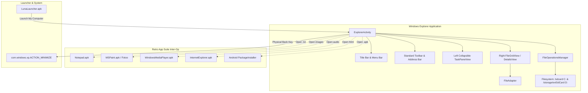

# Windows XP Explorer Implementation Plan

> **For agentic workers:** REQUIRED SUB-SKILL: Use superpowers:subagent-driven-development to implement this plan task-by-task. Steps use checkbox (`- [ ]`) syntax for tracking.

**Goal:** Build and bake an authentic Windows XP File Explorer (`WindowsExplorer.apk`) featuring two-pane collapsible Luna task pane, drive mappings (C: and D:), file type associations, and hardware key integration into the custom ROM.

**Architecture:** 
A native Android 4.4.2 application (`com.windows.xp.explorer`) built with a two-pane architecture: a left collapsible accordion `TaskPaneView` for system tasks and quick folders, and a right `FileGridView`/`ListView` driven by `FileAdapter` and `FileOperationsManager`. Inter-process intents seamlessly launch files into the custom retro suite (Notepad, Paint, WMP, IE). Physical hardware keys are mapped to navigate directory hierarchies or minimize to the Luna taskbar.

**Architecture Diagram:**

**Tech Stack:**
- Android SDK 19 (KitKat 4.4.2 API level 19)
- Java 8 (target 1.8 / Dalvik bytecode via D8)
- Android UI XML (RelativeLayout, LinearLayout, GridView, ListView)
- `aapt`, `zipalign`, `jarsigner` build pipeline
- WSL2 Ubuntu 22.04 LTS for ext4 loopback cooking & packaging

## Global Constraints
- Target hardware: Samsung Galaxy Tab 3 7.0 (SM-T210 / SM-T210R, `lt02wifi`)
- Display resolution: 1024x600 landscape
- Package name: `com.windows.xp.explorer`
- Min SDK: 19, Target SDK: 19
- Physical hardware key bindings: Home (Start Menu), Menu (Alt+Tab), Back (Up/Back or Minimize)
- Output artifacts: `apps/WindowsExplorer/WindowsExplorer.apk`, `WindowsXP_Tab3_Luna_v1.1_Odin.tar.md5`, `WindowsXP_Tab3_Luna_v1.1_TWRP.zip`

---

### Task 1: Assets & UI Layout Resources Scaffolding

**Files:**
- Create: `apps/WindowsExplorer/AndroidManifest.xml`
- Create: `apps/WindowsExplorer/res/values/colors.xml`
- Create: `apps/WindowsExplorer/res/values/strings.xml`
- Create: `apps/WindowsExplorer/res/values/styles.xml`
- Create: `apps/WindowsExplorer/res/layout/activity_explorer.xml`
- Create: `apps/WindowsExplorer/res/layout/item_file_grid.xml`
- Create: `apps/WindowsExplorer/res/layout/item_file_detail.xml`
- Create: `apps/WindowsExplorer/res/layout/item_task_card.xml`
- Create: `tools/generate_explorer_icons.py`

**Interfaces:**
- Produces: Layouts and drawable resources for Luna title bar, menus, toolbar, address bar, task pane, and file views.

- [ ] **Step 1: Write python icon generator script**
Generate authentic XP icons (Drive C, Drive D, Folder, TXT, IMG, Audio, App, Back, Forward, Up, Views, Delete, New Folder, Close).

- [ ] **Step 2: Run icon generator**
Run: `python tools/generate_explorer_icons.py`  
Expected: Generates PNG assets in `apps/WindowsExplorer/res/drawable-mdpi/`.

- [ ] **Step 3: Create AndroidManifest.xml and string/color/style resources**
Define theme, permissions (`READ_EXTERNAL_STORAGE`, `WRITE_EXTERNAL_STORAGE`), and Luna color palette (`#ECE9D8`, `#0055EA`, `#3A87F9`, `#7BA2E7`, `#215DC6`, `#D6DFF7`).

- [ ] **Step 4: Create XML layouts**
Create `activity_explorer.xml`, `item_file_grid.xml`, `item_file_detail.xml`, and `item_task_card.xml`.

- [ ] **Step 5: Commit resources**
Commit to git: `feat(explorer): scaffold XML layouts and Luna icons`.

---

### Task 2: Core Data Models & File Operations Manager

**Files:**
- Create: `apps/WindowsExplorer/src/com/windows/xp/explorer/model/FileItem.java`
- Create: `apps/WindowsExplorer/src/com/windows/xp/explorer/model/DriveItem.java`
- Create: `apps/WindowsExplorer/src/com/windows/xp/explorer/fs/FileOperationsManager.java`
- Create: `apps/WindowsExplorer/src/com/windows/xp/explorer/fs/MimeTypeResolver.java`

**Interfaces:**
- Produces: `FileItem`, `DriveItem`, `FileOperationsManager.scanDirectory()`, `FileOperationsManager.getDrives()`, `MimeTypeResolver.resolve()`.

- [ ] **Step 1: Implement FileItem and DriveItem models**
Data containers storing name, full path, file size formatted (KB/MB/GB), modification date, drive total/free space, and file type enum.

- [ ] **Step 2: Implement MimeTypeResolver**
Maps file extensions (`.txt`, `.png`, `.jpg`, `.mp3`, `.wav`, `.html`, `.apk`, `.zip`) to icons and MIME types.

- [ ] **Step 3: Implement FileOperationsManager**
Filesystem wrapper scanning `/sdcard` (Drive C:), `/storage/extSdCard` (Drive D:), and directories, plus create directory, delete, and rename.

- [ ] **Step 4: Commit core data models**
Commit to git: `feat(explorer): implement data models and filesystem manager`.

---

### Task 3: Collapsible Task Pane & File Adapters

**Files:**
- Create: `apps/WindowsExplorer/src/com/windows/xp/explorer/ui/TaskPaneView.java`
- Create: `apps/WindowsExplorer/src/com/windows/xp/explorer/ui/FileAdapter.java`

**Interfaces:**
- Produces: `TaskPaneView` (accordion UI for System Tasks, Other Places, Details), `FileAdapter` (rendering Icons, List, and Details modes).

- [ ] **Step 1: Implement TaskPaneView**
Accordion view supporting expand/collapse toggling, icon pill navigation links for My Computer, My Documents, My Pictures, My Music, Downloads, and a dynamic Details card.

- [ ] **Step 2: Implement FileAdapter**
Adapter supporting Grid (Large Icons), List, and Details view modes. Renders drive progress bars in "My Computer" view.

- [ ] **Step 3: Commit UI components**
Commit to git: `feat(explorer): implement TaskPaneView and FileAdapter`.

---

### Task 4: Main Explorer Activity, Hardware Keys & Inter-App Routing

**Files:**
- Create: `apps/WindowsExplorer/src/com/windows/xp/explorer/ExplorerActivity.java`

**Interfaces:**
- Produces: `ExplorerActivity` with full navigation history stack, address bar input, menu actions, physical key listeners, and file execution intents.

- [ ] **Step 1: Implement navigation history & address bar**
Handle Back/Forward stack, Up navigation, path dropdown, and "Go" button.

- [ ] **Step 2: Implement file click routing**
Launch `.txt` in Notepad, images in MSPaint/Fotoo, audio in WMP, `.apk` in PackageInstaller, `.html` in IE.

- [ ] **Step 3: Implement hardware key handler**
Override `dispatchKeyEvent`:
- Back key: if history stack has folders, pop history and load previous folder; if at root (`computer://`), broadcast `com.windows.xp.ACTION_MINIMIZE`.
- Home key: pass through or trigger Start Menu.

- [ ] **Step 4: Commit main activity**
Commit to git: `feat(explorer): implement ExplorerActivity and inter-app routing`.

---

### Task 5: Compilation, Device Sideload & Verification

**Files:**
- Output: `apps/WindowsExplorer/WindowsExplorer.apk`

- [ ] **Step 1: Compile APK with build_apk.sh**
Run: `wsl -d Ubuntu -u root /mnt/c/Users/gohil/Downloads/Samsung_Tab3_SM-T210_Tools/WindowsXP_ROM_Project/tools/build_apk.sh /mnt/c/Users/gohil/Downloads/Samsung_Tab3_SM-T210_Tools/WindowsXP_ROM_Project/apps/WindowsExplorer /mnt/c/Users/gohil/Downloads/Samsung_Tab3_SM-T210_Tools/WindowsXP_ROM_Project/apps/WindowsExplorer/WindowsExplorer.apk`  
Expected: `Build successful: .../WindowsExplorer.apk`.

- [ ] **Step 2: Sideload onto Galaxy Tab 3 7.0**
Run: `..\platform-tools\adb.exe install -r apps\WindowsExplorer\WindowsExplorer.apk`.

- [ ] **Step 3: Launch and verify live on device**
Run: `..\platform-tools\adb.exe shell am start -n com.windows.xp.explorer/.ExplorerActivity`.  
Verify: Two-pane layout displays properly, Drive C: shows internal storage, navigating into My Documents works, tapping text opens Notepad, Back button navigates up/minimizes.

- [ ] **Step 4: Commit compiled application**
Commit to git: `feat(explorer): compile and verify WindowsExplorer.apk on device`.

---

### Task 6: LunaLauncher Desktop & Start Menu Hook Integration

**Files:**
- Modify: `apps/LunaLauncher/src/com/windows/xp/launcher/LunaLauncherActivity.java`

- [ ] **Step 1: Update desktop "My Computer" icon click handler**
Launch `com.windows.xp.explorer/.ExplorerActivity` with URI `computer://`.

- [ ] **Step 2: Update Start Menu shortcuts**
Route "My Documents", "My Pictures", and "My Music" to launch `com.windows.xp.explorer` with target directory extra.

- [ ] **Step 3: Recompile and update LunaLauncher.apk**
Run `build_apk.sh` and reinstall `LunaLauncher.apk` on tablet via ADB.

- [ ] **Step 4: Commit launcher updates**
Commit to git: `feat(launcher): integrate Windows Explorer with desktop and Start Menu`.

---

### Task 7: Re-cook Master Custom ROM in WSL (v1.1 Release)

**Files:**
- Modify: `tools/cook_windows_xp_rom.sh`
- Output: `dist/WindowsXP_Tab3_Luna_v1.1_Odin.tar.md5`
- Output: `dist/WindowsXP_Tab3_Luna_v1.1_TWRP.zip`
- Modify: `walkthrough.md`

- [ ] **Step 1: Update cook_windows_xp_rom.sh to bake WindowsExplorer.apk**
Add `WindowsExplorer.apk` into `PRIV_APPS` mapping to be copied to `/system/priv-app/`. Update release filenames to `v1.1`.

- [ ] **Step 2: Run master cooking script in WSL**
Execute `tools/cook_windows_xp_rom.sh` as root in WSL Ubuntu.

- [ ] **Step 3: Verify v1.1 package integrity**
Run `unzip -t` on TWRP zip and verify Odin TAR.MD5 checksum.

- [ ] **Step 4: Update walkthrough.md and commit**
Update documentation and commit to git: `release: Windows XP Luna Custom ROM v1.1 with Windows Explorer`.
