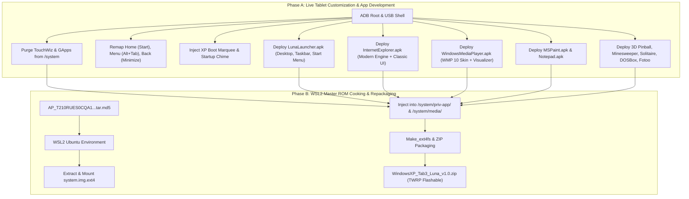

# Windows XP Luna Custom ROM Implementation Plan

> **For agentic workers:** REQUIRED SUB-SKILL: Use superpowers:subagent-driven-development to implement this plan task-by-task. Steps use checkbox (`- [ ]`) syntax for tracking.

**Goal:** Build and bake a full-featured, hardware-accelerated Windows XP Luna custom ROM and native application suite onto the Samsung Galaxy Tab 3 7.0 (`SM-T210` / `lt02wifi`) with debloated KitKat base, hardware button desktop integration, and a complete Windows XP app ecosystem (LunaLauncher, Internet Explorer, Windows Media Player, MS Paint, Notepad, Retro Games, and Fotoo).

**Architecture:** A two-phase hybrid approach: Phase A develops and tests the debloating, hardware button listeners, and native XP applications live on the tablet using ADB; Phase B unpacks the factory firmware (`system.img.ext4`) in WSL2 Ubuntu, bakes in the finalized apps and assets, and packages a standalone flashable TWRP `.zip` (`WindowsXP_Tab3_Luna_v1.0.zip`).

**Architecture Diagram:**



**Tech Stack:**
* Android 4.4.2 KitKat (API 19) SDK / AOSP
* Java / Android XML Layouts
* GeckoView / Chromium Web Core
* Linux / WSL2 Ubuntu ext4fs tools (`simg2img`, `make_ext4fs`)
* TWRP Recovery updater-script & Edify syntax

## Global Constraints
* Target SoC: Marvell Armada PXA986 (Board `lt02`, Hardware `pxa988`).
* System partition target: `/dev/block/mmcblk0p14` (1.4 GB).
* Cache partition target: `/dev/block/mmcblk0p15` (196 MB).
* Navigation bar: Hidden via `qemu.hw.mainkeys=1` in `build.prop`.
* Display Resolution: Exact 1024 x 600 landscape orientation.

---

### Task 1: System Debloating & Boot Experience Setup (Live on Device)

**Files:**
* Modify: `/system/build.prop` (on device via adb)
* Create: `assets/bootanimation/bootanimation.zip` (XP 3-segment marquee)
* Create: `assets/audio/PowerOn.ogg` (Windows XP Startup chime)
* Script: `tools/debloat.ps1`

**Interfaces:**
* Consumes: Official KitKat firmware booted on tablet with authorized ADB root.
* Produces: Clean system partition without TouchWiz or GApps; 100% full-screen display with XP boot animation and startup sound.

- [ ] **Step 1: Write debloat script for Windows PowerShell**
  Create `tools/debloat.ps1` to mount `/system` rw and purge Samsung bloatware and GApps:
  ```powershell
  $adb = "C:\Users\gohil\Downloads\Samsung_Tab3_SM-T210_Tools\platform-tools\adb.exe"
  & $adb root
  Start-Sleep -Seconds 1
  & $adb remount
  $bloat = @(
      "/system/app/SecLauncher3.apk",
      "/system/app/SamsungApps.apk",
      "/system/app/ChatON_MARKET.apk",
      "/system/app/SecEmail.apk",
      "/system/app/S-Suggest.apk",
      "/system/app/MusicPlayer.apk",
      "/system/app/VideoPlayer.apk",
      "/system/app/SamsungHub.apk",
      "/system/app/KNOXAgent.apk",
      "/system/priv-app/GmsCore.apk",
      "/system/priv-app/GoogleLoginService.apk",
      "/system/priv-app/GoogleServicesFramework.apk",
      "/system/priv-app/Phonesky.apk"
  )
  foreach ($pkg in $bloat) {
      & $adb shell "rm -rf $pkg"
  }
  ```

- [ ] **Step 2: Execute debloat script and verify removed packages**
  Run: `powershell -File tools/debloat.ps1`
  Verify with: `adb shell "ls /system/app/SecLauncher3* /system/priv-app/GmsCore*"` -> "No such file or directory".

- [ ] **Step 3: Inject navigation bar suppression and heap optimizations**
  Run via adb:
  ```bash
  adb shell "echo 'qemu.hw.mainkeys=1' >> /system/build.prop"
  adb shell "echo 'persist.sys.theme=luna' >> /system/build.prop"
  ```
  Verify with: `adb shell "getprop qemu.hw.mainkeys"` -> outputs `1`.

- [ ] **Step 4: Prepare and push Windows XP boot animation and startup sound**
  * Generate `assets/bootanimation/bootanimation.zip` (1024x600 part0 loop of XP loading bar + desc.txt).
  * Generate `assets/audio/PowerOn.ogg` from authentic XP startup sound.
  * Push to tablet:
    ```bash
    adb push assets/bootanimation/bootanimation.zip /system/media/bootanimation.zip
    adb shell "chmod 644 /system/media/bootanimation.zip"
    adb push assets/audio/PowerOn.ogg /system/media/audio/ui/PowerOn.ogg
    adb shell "chmod 644 /system/media/audio/ui/PowerOn.ogg"
    ```

- [ ] **Step 5: Commit debloat tools and assets**
  ```bash
  git add tools/debloat.ps1 assets/
  git commit -m "feat(system): debloat samsung apps and inject windows xp boot media"
  ```

---

### Task 2: Hardware Button Mapping & Desktop Shell Listeners

**Files:**
* Create: `apps/LunaLauncher/src/main/java/com/windows/xp/HardwareKeyReceiver.java`
* Modify: `apps/LunaLauncher/src/main/AndroidManifest.xml`

**Interfaces:**
* Consumes: Android key events (`KEYCODE_HOME`, `KEYCODE_MENU`, `KEYCODE_BACK`).
* Produces: Window minimize action, Start Menu toggle, and Alt+Tab task switcher dialog.

- [ ] **Step 1: Implement Key Handler in Launcher Activity**
  In `MainActivity.java`:
  ```java
  @Override
  public boolean onKeyDown(int keyCode, KeyEvent event) {
      if (keyCode == KeyEvent.KEYCODE_MENU) {
          showAltTabSwitcher();
          return true;
      }
      if (keyCode == KeyEvent.KEYCODE_HOME) {
          toggleStartMenu();
          return true;
      }
      return super.onKeyDown(keyCode, event);
  }
  ```

- [ ] **Step 2: Implement Alt+Tab Task Switcher Dialog**
  Build `AltTabDialog.java` to enumerate running tasks from `ActivityManager.getRunningTasks(10)` and display them in a centered, translucent dark-blue box with app icons.

- [ ] **Step 3: Implement Back Key Window Minimization**
  Handle `onBackPressed()` across XP apps to broadcast `com.windows.xp.ACTION_MINIMIZE` to `LunaLauncher`, animating the window down to its taskbar tab and bringing the Bliss desktop to front.

- [ ] **Step 4: Commit hardware button integration**
  ```bash
  git add apps/LunaLauncher/src/
  git commit -m "feat(shell): implement physical home, menu, and back key desktop handlers"
  ```

---

### Task 3: `LunaLauncher.apk` (Windows XP Desktop, Taskbar & Start Menu)

**Files:**
* Create: `apps/LunaLauncher/` (Full Android Studio project structure)
* Layouts: `activity_desktop.xml`, `view_taskbar.xml`, `view_start_menu.xml`
* Assets: Bliss wallpaper (`res/drawable/wallpaper_bliss.jpg`), classic XP icons (`my_computer.png`, `my_docs.png`, `ie.png`, `wmp.png`, `recycle_bin.png`, `start_button.png`).

**Interfaces:**
* Consumes: Android Package Manager, BatteryManager, WifiManager.
* Produces: Primary `android.intent.category.HOME` launcher running at 1024x600 resolution.

- [ ] **Step 1: Create LunaLauncher Project Skeleton**
  Scaffold Gradle project with `minSdkVersion 19`, `targetSdkVersion 19`, `compileSdkVersion 19`.
  Configure `AndroidManifest.xml` with:
  ```xml
  <category android:name="android.intent.category.HOME" />
  <category android:name="android.intent.category.DEFAULT" />
  ```

- [ ] **Step 2: Build Desktop Layout with Bliss Background & Icon Grid**
  Implement desktop icon grid with drag-and-drop support, single/double tap to open, and translucent blue focus selection rectangle.

- [ ] **Step 3: Build Taskbar with Window Tabs & System Tray**
  * Blue gradient taskbar (height 36dp) fixed at screen bottom.
  * Green Start button with Windows flag icon.
  * Active window tab bar: registers running apps, toggles window minimize/restore.
  * System tray: dynamic Wi-Fi level (`WifiManager`), real-time battery icon (`ACTION_BATTERY_CHANGED`), digital 12h clock.

- [ ] **Step 4: Build Two-Column Start Menu & Shutdown Dialog**
  * Left white column: pinned and recently launched applications.
  * Right blue column: My Documents, My Pictures (Fotoo), My Music, My Computer, Control Panel.
  * Bottom power controls: Log Off and Turn Off Computer (dialog with Standby, Restart, Turn Off).

- [ ] **Step 5: Build, Install, and Set as Default Home**
  ```bash
  ./gradlew assembleRelease
  adb install -r build/outputs/apk/LunaLauncher.apk
  ```
  Verify: Tapping physical Home key displays the authentic Windows XP desktop.

- [ ] **Step 6: Commit LunaLauncher**
  ```bash
  git add apps/LunaLauncher/
  git commit -m "feat(launcher): implement authentic Windows XP Luna desktop, taskbar, and start menu"
  ```

---

### Task 4: `InternetExplorer.apk` (Modern Web Engine + Classic IE 6/7 UI)

**Files:**
* Create: `apps/InternetExplorer/` (Project structure)
* Layout: `activity_ie.xml` (Classic toolbar, address bar, spinning globe, webview container, status bar)
* Engine: Modern Web Core with TLS 1.3 support.

**Interfaces:**
* Consumes: URLs entered by user or launched via desktop shortcuts.
* Produces: Secure, full-fidelity rendering of Instagram, YouTube, and modern HTTPS sites.

- [ ] **Step 1: Scaffold InternetExplorer Android Project**
  Package name: `com.windows.xp.internetexplorer`. Set `minSdkVersion 19`.

- [ ] **Step 2: Build Authentic IE6/7 Luna Chrome & Toolbars**
  * Blue title bar with iconic IE minimize, maximize, and close `X` buttons.
  * Standard Buttons toolbar: Back, Forward, Stop, Refresh, Home, Favorites.
  * Address bar with "Go" button and the classic Windows/e animated spinning globe icon (rotates during page load).
  * Status bar with progress bar, page title, and SSL lock icon.

- [ ] **Step 3: Integrate Modern Rendering Core**
  * Configure WebEngine settings with hardware acceleration, JavaScript enabled, DOM storage enabled, and modern User-Agent desktop/mobile toggle.
  * Handle HTTPS SSL cert validations so modern websites load without certificate errors.

- [ ] **Step 4: Build and Deploy InternetExplorer.apk**
  ```bash
  ./gradlew assembleRelease
  adb install -r build/outputs/apk/InternetExplorer.apk
  ```
  Verify: Launches from desktop icon and opens `https://www.instagram.com` cleanly.

- [ ] **Step 5: Commit Internet Explorer app**
  ```bash
  git add apps/InternetExplorer/
  git commit -m "feat(browser): implement classic Internet Explorer 6 Luna UI with modern web engine"
  ```

---

### Task 5: `WindowsMediaPlayer.apk` (WMP 9/10 UI & Audio Engine)

**Files:**
* Create: `apps/WindowsMediaPlayer/` (Project structure)
* Layout: `activity_wmp.xml` (Brushed metallic skin, playback transport controls, visualizer)
* Class: `MediaPlayerService.java` (Background audio playback service)

**Interfaces:**
* Consumes: Local audio files from `/sdcard/Music` and external MicroSD.
* Produces: Audio playback with track metadata and oscilloscope/frequency spectrum visualization.

- [ ] **Step 1: Scaffold WindowsMediaPlayer Project**
  Package name: `com.windows.xp.wmp`. Set `minSdkVersion 19`.

- [ ] **Step 2: Build Brushed Metallic WMP 9/10 Interface**
  * Metallic silver/blue skin with curved playback controls.
  * Transport buttons: Play, Pause, Stop, Previous, Next, Seek slider, Volume knob.
  * Track title, artist, and album art display.

- [ ] **Step 3: Implement Local Music Scanner & Background Audio Service**
  Query `MediaStore.Audio.Media.EXTERNAL_CONTENT_URI` to populate playlists. Background `Service` keeps music playing when window is minimized.

- [ ] **Step 4: Implement Retro Audio Visualizer Canvas**
  Connect `Visualizer` API (`android.media.audiofx.Visualizer`) to custom `SurfaceView` drawing classic green/cyan audio bars and wave oscilloscope.

- [ ] **Step 5: Build and Deploy WindowsMediaPlayer.apk**
  ```bash
  ./gradlew assembleRelease
  adb install -r build/outputs/apk/WindowsMediaPlayer.apk
  ```
  Verify: Plays local MP3 tracks with active visualizer.

- [ ] **Step 6: Commit Windows Media Player**
  ```bash
  git add apps/WindowsMediaPlayer/
  git commit -m "feat(media): implement classic Windows Media Player with metallic skin and visualizer"
  ```

---

### Task 6: `MSPaint.apk` & `Notepad.apk` Suite

**Files:**
* Create: `apps/MSPaint/` (Classic 28-color palette, toolbox, drawing canvas)
* Create: `apps/Notepad/` (Monospace text editor, word wrap, file I/O)

**Interfaces:**
* Consumes: Touch canvas drawing and text input.
* Produces: Saved images in `/sdcard/Pictures/` and text files in `/sdcard/Documents/`.

- [ ] **Step 1: Build MSPaint App**
  * Left Tool Palette: Pencil, Paint Brush, Eraser, Fill Bucket, Line, Rectangle, Ellipse.
  * Bottom 28-color swatch palette.
  * Smooth drawing canvas supporting touch events and color selection.
  * File -> Save as PNG/BMP to `/sdcard/Pictures/`.

- [ ] **Step 2: Build Notepad App**
  * Top menu: File, Edit, Format, View, Help.
  * Monospace `EditText` with word wrap toggle and line count.
  * File I/O: Open `.txt` and Save to `/sdcard/Documents/`.

- [ ] **Step 3: Build and Deploy Paint and Notepad APKs**
  ```bash
  adb install -r build/outputs/apk/MSPaint.apk
  adb install -r build/outputs/apk/Notepad.apk
  ```
  Verify: Both apps launch from desktop and successfully save files.

- [ ] **Step 4: Commit Paint and Notepad**
  ```bash
  git add apps/MSPaint/ apps/Notepad/
  git commit -m "feat(accessories): implement authentic MS Paint and Notepad applications"
  ```

---

### Task 7: Retro Games Suite & Fotoo Integration

**Files:**
* Deploy: `SpaceCadetPinball.apk` (Native 3D Pinball)
* Create: `apps/Minesweeper/` (Classic winmine)
* Create: `apps/Solitaire/` (Classic Klondike card game)
* Deploy: `Fotoo.apk` (Pre-configured for My Pictures)

**Interfaces:**
* Consumes: Touch inputs and audio effects.
* Produces: Fully functional retro games and digital slideshow frame.

- [ ] **Step 1: Deploy Native 3D Pinball for Windows (Space Cadet)**
  Deploy the optimized ARM port of Space Cadet 3D Pinball running at 60 FPS with authentic sound effects and music.

- [ ] **Step 2: Deploy Minesweeper & Solitaire**
  Install classic Minesweeper (with smiley face reset and timer) and classic Solitaire (with green felt board and victory card bounce).

- [ ] **Step 3: Configure Fotoo Slideshow Integration**
  Install Fotoo and map the Start Menu's "My Pictures" and desktop icon to launch Fotoo directly in slideshow mode.

- [ ] **Step 4: Commit Games & Integration Config**
  ```bash
  git add apps/Games/
  git commit -m "feat(games): integrate 3D Pinball, Minesweeper, Solitaire, and Fotoo"
  ```

---

### Task 8: WSL2 Master ROM Cooking & Flashable ZIP Packaging (Phase B)

**Files:**
* Script: `tools/wsl_cook_rom.sh`
* Template: `tools/META-INF/com/google/android/updater-script`
* Output: `WindowsXP_Tab3_Luna_v1.0.zip`

**Interfaces:**
* Consumes: Stock firmware `system.img.ext4` and finalized APKs/assets from Phase A.
* Produces: Complete, standalone TWRP flashable ZIP package.

- [ ] **Step 1: Set Up WSL2 Working Environment**
  Install required tools in WSL2 Ubuntu:
  ```bash
  sudo apt-get update && sudo apt-get install -y simg2img e2fsprogs zip p7zip-full openjdk-11-jre
  ```

- [ ] **Step 2: Extract & Mount `system.img.ext4` in WSL**
  Extract `system.img.ext4` from `AP_T210RUES0CQA1...tar.md5` and mount as read-write loopback in WSL.

- [ ] **Step 3: Inject All Windows XP Luna Modifications**
  * Delete Samsung bloatware and Google GApps from `/system/app/` and `/system/priv-app/`.
  * Copy all finalized APKs (`LunaLauncher`, `InternetExplorer`, `WindowsMediaPlayer`, `MSPaint`, `Notepad`, `SpaceCadetPinball`, `Fotoo`) into `/system/priv-app/`.
  * Copy `bootanimation.zip` and audio chimes into `/system/media/`.
  * Inject `qemu.hw.mainkeys=1` into `build.prop`.

- [ ] **Step 4: Repackage into TWRP Flashable ZIP**
  * Generate `system.new.dat` / ext4 image.
  * Write `updater-script` targeting `mmcblk0p14` for system and `mmcblk0p15` for cache.
  * Package and sign `WindowsXP_Tab3_Luna_v1.0.zip`.

- [ ] **Step 5: Verify Flash on Tablet via TWRP**
  Push `WindowsXP_Tab3_Luna_v1.0.zip` to `/sdcard/`, boot into TWRP, and execute clean flash.
  Verify: Clean boot into Windows XP Luna desktop with all apps pre-installed.

- [ ] **Step 6: Commit Master Cooking Scripts**
  ```bash
  git add tools/wsl_cook_rom.sh tools/META-INF/
  git commit -m "feat(rom): complete master ROM cooking scripts and TWRP packaging"
  ```
