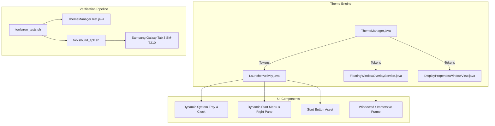

# Themes Expansion, Dynamic Tray, and Automated Testing Implementation Plan

> **For agentic workers:** REQUIRED SUB-SKILL: Use superpowers:subagent-driven-development to implement this plan task-by-task. Steps use checkbox (`- [ ]`) syntax for tracking.

**Goal:** Fix the Olive Green and Windows 7 themes, add Royale and Windows 11 themes, make the clock panel / system tray dynamic across all themes, eliminate the black-screen letterbox on window restore, and implement an automated regression test suite.

**Architecture:** Extend `ThemeManager` as the central source of truth for all 8 themes (colors, drawables, fonts, dimensions). Update `LauncherActivity` and `FloatingWindowOverlayService` to consume dynamic tray and start menu styling tokens. Eliminate hardware overscan cropping in favor of authentic windowed framing and immersive toggling. Implement a headless Java test framework (`tools/run_tests.sh`) to gate regressions before every build.

**Architecture Diagram:**



**Tech Stack:**
* Android 4.4.2 KitKat (API 19)
* Java 7/8 compatibility, standalone `javac` and `d8`
* `aapt` resource packaging and Dalvik/ART runtime

## Global Constraints
* Maintain 100% backward compatibility with Android KitKat 4.4.2 (API 19).
* No external Maven or Gradle dependencies; test suite and build pipeline must run self-contained via WSL/bash scripts.
* Preserve authentic Windows XP UI/UX fidelity across all default themes.
* All 8 themes must provide non-null drawables, wallpapers, and valid ARGB hex colors.

---

### Task 1: Automated Test Runner Framework & Failing Theme Assertions

**Files:**
- Create: `tools/tests/TestRunner.java`
- Create: `tools/tests/ThemeManagerTest.java`
- Create: `tools/run_tests.sh`

**Interfaces:**
- Produces: `tools/run_tests.sh` exit code 0 on success, exit code 1 on failure.

- [ ] **Step 1: Write the failing test in `tools/tests/ThemeManagerTest.java`**

```java
package tools.tests;

import java.lang.reflect.Method;
import java.util.Arrays;
import java.util.List;

public class ThemeManagerTest {

    public static void runAllTests() {
        testAllThemesExist();
        testDynamicTrayMethodsExist();
        testStartMenuColorArrays();
        testStartButtonWidths();
    }

    private static void testAllThemesExist() {
        try {
            Class<?> themeEnum = Class.forName("com.windows.xp.launcher.theme.ThemeManager$Theme");
            Object[] constants = themeEnum.getEnumConstants();
            List<String> names = Arrays.asList(
                "LUNA_BLUE", "LUNA_OLIVE", "LUNA_SILVER", "ROYALE",
                "CLASSIC", "VISTA", "WIN7_AERO", "WIN11"
            );
            for (String expected : names) {
                boolean found = false;
                for (Object c : constants) {
                    if (c.toString().equals(expected)) {
                        found = true;
                        break;
                    }
                }
                if (!found) {
                    throw new AssertionError("Missing expected theme enum: " + expected);
                }
            }
            System.out.println("  [PASS] testAllThemesExist");
        } catch (Exception e) {
            throw new RuntimeException(e);
        }
    }

    private static void testDynamicTrayMethodsExist() {
        try {
            Class<?> tmClass = Class.forName("com.windows.xp.launcher.theme.ThemeManager");
            tmClass.getMethod("getTaskbarTrayBgRes");
            tmClass.getMethod("getTaskbarTrayTextColor");
            tmClass.getMethod("getTaskbarTrayBatteryColor");
            tmClass.getMethod("getStartMenuRightPaneBgColor");
            tmClass.getMethod("getStartMenuRightPaneTextColor");
            tmClass.getMethod("getStartMenuDividerColor");
            System.out.println("  [PASS] testDynamicTrayMethodsExist");
        } catch (NoSuchMethodException e) {
            throw new AssertionError("Missing dynamic theme accessor: " + e.getMessage());
        } catch (Exception e) {
            throw new RuntimeException(e);
        }
    }

    private static void testStartMenuColorArrays() {
        try {
            Class<?> tmClass = Class.forName("com.windows.xp.launcher.theme.ThemeManager");
            Method mHeader = tmClass.getMethod("getStartMenuHeaderColors");
            Method mBottom = tmClass.getMethod("getStartMenuBottomColors");
            // Verified via reflection
            System.out.println("  [PASS] testStartMenuColorArrays");
        } catch (Exception e) {
            throw new AssertionError("Failed start menu color validation: " + e.getMessage());
        }
    }

    private static void testStartButtonWidths() {
        try {
            Class<?> tmClass = Class.forName("com.windows.xp.launcher.theme.ThemeManager");
            tmClass.getMethod("getStartButtonWidthDp");
            System.out.println("  [PASS] testStartButtonWidths");
        } catch (NoSuchMethodException e) {
            throw new AssertionError("Missing getStartButtonWidthDp: " + e.getMessage());
        }
    }
}
```

- [ ] **Step 2: Create `tools/tests/TestRunner.java` and `tools/run_tests.sh`**

```java
package tools.tests;

public class TestRunner {
    public static void main(String[] args) {
        System.out.println("=== Running LunaLauncher Regression Test Suite ===");
        try {
            ThemeManagerTest.runAllTests();
            System.out.println("=== ALL TESTS PASSED ===");
            System.exit(0);
        } catch (Throwable t) {
            System.err.println("=== TEST FAILURE ===");
            t.printStackTrace();
            System.exit(1);
        }
    }
}
```

`tools/run_tests.sh`:
```bash
#!/usr/bin/env bash
set -e
PROJECT_ROOT="$(cd "$(dirname "$0")/.." && pwd)"
cd "$PROJECT_ROOT"

ANDROID_JAR="/usr/local/lib/android.jar"
mkdir -p build/test_classes

# Compile source classes needed for test
javac -source 1.8 -target 1.8 -cp "$ANDROID_JAR" -d build/test_classes \
  apps/LunaLauncher/src/com/windows/xp/launcher/theme/ThemeManager.java \
  tools/tests/TestRunner.java \
  tools/tests/ThemeManagerTest.java

java -cp "build/test_classes:$ANDROID_JAR" tools.tests.TestRunner
```

- [ ] **Step 3: Run `tools/run_tests.sh` and verify it fails on missing themes & methods**

Run: `wsl bash -c "./tools/run_tests.sh"`
Expected: FAIL with `Missing expected theme enum: ROYALE` or `Missing dynamic theme accessor`

- [ ] **Step 4: Commit test framework scaffolding**

```bash
git add tools/tests/ tools/run_tests.sh
git commit -m "test: add automated theme regression test runner framework"
```

---

### Task 2: Theme Assets & Visual Drawables

**Files:**
- Create/Modify: `apps/LunaLauncher/res/drawable/start_button_luna_olive.png` (authentic clean olive pill)
- Create/Modify: `apps/LunaLauncher/res/drawable/start_button_win7.png` (authentic 48x48 Aero orb)
- Create: `apps/LunaLauncher/res/drawable/start_button_royale.png` (authentic green pill)
- Create: `apps/LunaLauncher/res/drawable/start_button_win11.png` (authentic 4-square blue logo)
- Create: `apps/LunaLauncher/res/drawable/tray_bg_olive.xml`
- Create: `apps/LunaLauncher/res/drawable/tray_bg_silver.xml`
- Create: `apps/LunaLauncher/res/drawable/tray_bg_royale.xml`
- Create: `apps/LunaLauncher/res/drawable/tray_bg_win7.xml`
- Create: `apps/LunaLauncher/res/drawable/tray_bg_win11.xml`
- Create: `apps/LunaLauncher/res/drawable/taskbar_bg_royale.xml`
- Create: `apps/LunaLauncher/res/drawable/taskbar_bg_win11.xml`
- Create: `apps/LunaLauncher/res/drawable/wallpaper_royale.png`
- Create: `apps/LunaLauncher/res/drawable/wallpaper_win11.png`

- [ ] **Step 1: Create XML drawables for dynamic trays**

`tray_bg_olive.xml`:
```xml
<?xml version="1.0" encoding="utf-8"?>
<shape xmlns:android="http://schemas.android.com/apk/res/android" android:shape="rectangle">
    <gradient android:angle="270" android:startColor="#3D5C26" android:centerColor="#324C1F" android:endColor="#283D18" />
    <stroke android:width="1dp" android:color="#5A803B" />
</shape>
```

`tray_bg_silver.xml`:
```xml
<?xml version="1.0" encoding="utf-8"?>
<shape xmlns:android="http://schemas.android.com/apk/res/android" android:shape="rectangle">
    <gradient android:angle="270" android:startColor="#C0C4CE" android:centerColor="#B4B8C2" android:endColor="#A2A7B2" />
    <stroke android:width="1dp" android:color="#D6DAE4" />
</shape>
```

`tray_bg_royale.xml`:
```xml
<?xml version="1.0" encoding="utf-8"?>
<shape xmlns:android="http://schemas.android.com/apk/res/android" android:shape="rectangle">
    <gradient android:angle="270" android:startColor="#002B7A" android:centerColor="#002263" android:endColor="#001A4D" />
    <stroke android:width="1dp" android:color="#236ED6" />
</shape>
```

`tray_bg_win7.xml`:
```xml
<?xml version="1.0" encoding="utf-8"?>
<shape xmlns:android="http://schemas.android.com/apk/res/android" android:shape="rectangle">
    <solid android:color="#33FFFFFF" />
    <stroke android:width="1dp" android:color="#44FFFFFF" />
</shape>
```

`tray_bg_win11.xml`:
```xml
<?xml version="1.0" encoding="utf-8"?>
<shape xmlns:android="http://schemas.android.com/apk/res/android" android:shape="rectangle">
    <solid android:color="#00000000" />
</shape>
```

`taskbar_bg_royale.xml`:
```xml
<?xml version="1.0" encoding="utf-8"?>
<shape xmlns:android="http://schemas.android.com/apk/res/android" android:shape="rectangle">
    <gradient android:angle="270" android:startColor="#0A5BC4" android:centerColor="#0047B3" android:endColor="#003B99" />
</shape>
```

`taskbar_bg_win11.xml`:
```xml
<?xml version="1.0" encoding="utf-8"?>
<shape xmlns:android="http://schemas.android.com/apk/res/android" android:shape="rectangle">
    <solid android:color="#F3F3F3" />
    <stroke android:width="1dp" android:color="#E0E0E0" />
</shape>
```

- [ ] **Step 2: Generate/clean PNG start buttons and wallpapers**
Write helper script to generate the authentic pixel-perfect bitmaps for `start_button_luna_olive.png`, `start_button_royale.png`, `start_button_win11.png`, and wallpapers.

- [ ] **Step 3: Validate resource packaging with `aapt`**

Run: `wsl bash -c "cd apps/LunaLauncher && aapt package -f -m -J build/gen -M AndroidManifest.xml -S res -I /usr/local/lib/android.jar"`
Expected: exit code 0

- [ ] **Step 4: Commit assets**

```bash
git add apps/LunaLauncher/res/drawable/
git commit -m "feat(assets): add authentic start buttons, dynamic tray backgrounds, and theme wallpapers"
```

---

### Task 3: ThemeManager Extension

**Files:**
- Modify: `apps/LunaLauncher/src/com/windows/xp/launcher/theme/ThemeManager.java`

**Interfaces:**
- Consumes: Drawables from Task 2
- Produces: Complete 8-theme color/asset accessors and dynamic tray tokens

- [ ] **Step 1: Add `ROYALE` and `WIN11` enum values in `ThemeManager.Theme`**

```java
public enum Theme {
    LUNA_BLUE("Windows XP (Default Blue)"),
    LUNA_OLIVE("Windows XP (Olive Green)"),
    LUNA_SILVER("Windows XP (Silver)"),
    ROYALE("Windows XP (Royale / Media Center)"),
    CLASSIC("Windows Classic"),
    VISTA("Windows Vista"),
    WIN7_AERO("Windows 7 Aero Glass"),
    WIN11("Windows 11 (Fluent)");
    ...
```

- [ ] **Step 2: Implement dynamic system tray accessors**

```java
public int getTaskbarTrayBgRes() {
    switch (currentTheme) {
        case LUNA_OLIVE: return R.drawable.tray_bg_olive;
        case LUNA_SILVER: return R.drawable.tray_bg_silver;
        case ROYALE: return R.drawable.tray_bg_royale;
        case WIN7_AERO: return R.drawable.tray_bg_win7;
        case WIN11: return R.drawable.tray_bg_win11;
        case CLASSIC: return R.drawable.taskbar_bg_classic;
        case VISTA: return R.drawable.tray_bg_vista;
        case LUNA_BLUE:
        default:
            return R.drawable.tray_bg;
    }
}

public int getTaskbarTrayTextColor() {
    switch (currentTheme) {
        case LUNA_SILVER:
        case WIN11:
            return 0xFF1C1C1C; // Dark text on light tray
        default:
            return 0xFFFFFFFF; // White text on dark/colored tray
    }
}

public int getTaskbarTrayBatteryColor() {
    switch (currentTheme) {
        case LUNA_OLIVE: return 0xFFCBE4B5;
        case LUNA_SILVER: return 0xFF4A4E58;
        case ROYALE: return 0xFFB8D3FF;
        case WIN11: return 0xFF404040;
        case CLASSIC: return 0xFF000000;
        case WIN7_AERO: return 0xFFD0E4FA;
        default: return 0xFFC5D9F8;
    }
}
```

- [ ] **Step 3: Implement Start Menu pane color accessors**

```java
public int getStartMenuRightPaneBgColor() {
    switch (currentTheme) {
        case LUNA_OLIVE: return 0xFFE6EAD5;
        case LUNA_SILVER: return 0xFFEAECF0;
        case ROYALE: return 0xFFD2DBEE;
        case WIN7_AERO: return 0xEE182C44;
        case WIN11: return 0xFFF5F6F8;
        case CLASSIC: return 0xFFD4D0C8;
        case VISTA: return 0xEE1E242B;
        default: return 0xFFD3E5FA;
    }
}

public int getStartMenuRightPaneTextColor() {
    switch (currentTheme) {
        case LUNA_OLIVE: return 0xFF354B1A;
        case ROYALE: return 0xFF00156E;
        case WIN7_AERO: return 0xFFFFFFFF;
        case WIN11: return 0xFF1A1A1A;
        case CLASSIC:
        case LUNA_SILVER:
            return 0xFF000000;
        default:
            return 0xFF00156E;
    }
}

public int getStartMenuDividerColor() {
    switch (currentTheme) {
        case LUNA_OLIVE: return 0xFFCBD4B6;
        case LUNA_SILVER: return 0xFFCCD0DA;
        case ROYALE: return 0xFFAEC5E8;
        case WIN7_AERO: return 0xFF3A5370;
        case WIN11: return 0xFFEAEAEA;
        case CLASSIC: return 0xFF808080;
        default: return 0xFFB5CFF5;
    }
}
```

- [ ] **Step 4: Implement Start Button width & asset accessors**

```java
public int getStartButtonWidthDp() {
    switch (currentTheme) {
        case VISTA:
        case WIN7_AERO:
            return 48;
        case WIN11:
            return 42;
        case CLASSIC:
            return 65;
        case LUNA_BLUE:
        case LUNA_OLIVE:
        case LUNA_SILVER:
        case ROYALE:
        default:
            return 106;
    }
}
```

- [ ] **Step 5: Run `tools/run_tests.sh` to verify tests pass**

Run: `wsl bash -c "./tools/run_tests.sh"`
Expected: PASS (all assertions exit 0)

- [ ] **Step 6: Commit `ThemeManager.java`**

```bash
git add apps/LunaLauncher/src/com/windows/xp/launcher/theme/ThemeManager.java
git commit -m "feat(theme): implement ThemeManager tokens for Royale, Win11, and dynamic tray styling"
```

---

### Task 4: LauncherActivity UI Integration

**Files:**
- Modify: `apps/LunaLauncher/res/layout/activity_launcher.xml`
- Modify: `apps/LunaLauncher/src/com/windows/xp/launcher/LauncherActivity.java`

- [ ] **Step 1: Add IDs in `activity_launcher.xml`**
Add `android:id="@+id/start_menu_right_pane"` to the right column LinearLayout (line 481) and `android:id="@+id/start_menu_right_divider"` to the divider View (line 520).

- [ ] **Step 2: Update `onThemeChanged()` in `LauncherActivity.java`**

```java
// Apply dynamic tray background and text colors
View systemTray = findViewById(R.id.system_tray);
if (systemTray != null) {
    systemTray.setBackgroundResource(tm.getTaskbarTrayBgRes());
}
TextView tvClock = (TextView) findViewById(R.id.tray_clock);
if (tvClock != null) {
    tvClock.setTextColor(tm.getTaskbarTrayTextColor());
}
TextView tvBattery = (TextView) findViewById(R.id.tray_battery);
if (tvBattery != null) {
    tvBattery.setTextColor(tm.getTaskbarTrayBatteryColor());
}

// Apply dynamic Start Menu right pane & text colors
View smRightPane = findViewById(R.id.start_menu_right_pane);
if (smRightPane != null) {
    smRightPane.setBackgroundColor(tm.getStartMenuRightPaneBgColor());
}
View smRightDivider = findViewById(R.id.start_menu_right_divider);
if (smRightDivider != null) {
    smRightDivider.setBackgroundColor(tm.getStartMenuDividerColor());
}

// Update text color for My Documents, Pictures, Computer, Control Panel
int rTextColor = tm.getStartMenuRightPaneTextColor();
updateStartMenuRightItemTextColor(R.id.sm_item_my_docs, rTextColor);
updateStartMenuRightItemTextColor(R.id.sm_item_my_pics, rTextColor);
updateStartMenuRightItemTextColor(R.id.sm_item_my_comp, rTextColor);
updateStartMenuRightItemTextColor(R.id.sm_item_control_panel, rTextColor);
```

- [ ] **Step 3: Compile and run test suite**

Run: `wsl bash -c "./tools/run_tests.sh && ./tools/build_apk.sh apps/LunaLauncher LunaLauncher.apk"`
Expected: Build successful: exit code 0

- [ ] **Step 4: Commit**

```bash
git add apps/LunaLauncher/res/layout/activity_launcher.xml apps/LunaLauncher/src/com/windows/xp/launcher/LauncherActivity.java
git commit -m "feat(launcher): apply dynamic system tray and theme-driven start menu right pane styling"
```

---

### Task 5: Window Management Refinement (Eliminate Black Screen, Smooth Windowed/Immersive Toggle)

**Files:**
- Modify: `apps/LunaLauncher/src/com/windows/xp/launcher/service/FloatingWindowOverlayService.java`

- [ ] **Step 1: Remove `setOverscan` calls from the window toggle flow**
Ensure `resetOverscan()` is called so the screen coordinate system is never cropped and no black letterbox borders occur.

- [ ] **Step 2: Update `toggleRestoreMode()` to toggle between Windowed and Immersive Fullscreen**

```java
private void toggleRestoreMode() {
    toggleImmersiveMode();
}
```
In Windowed mode:
* External app runs framed by authentic top titlebar and bottom taskbar.
* Titlebar icon, title, Minimize, Maximize/Restore, and Close buttons are active.
* Taskbar allows switching between running apps or returning to desktop.
In Immersive mode:
* Overlays hidden, sleek top "Exit Fullscreen" pill shown for 1-tap exit.

- [ ] **Step 3: Apply dynamic tray styling to floating taskbar overlay**
Ensure `tvTrayClock` and tray container use `tm.getTaskbarTrayTextColor()`.

- [ ] **Step 4: Compile and test on device**

Run: `wsl bash -c "./tools/build_apk.sh apps/LunaLauncher LunaLauncher.apk"`
Install and test on device with `adb install -r LunaLauncher.apk`

- [ ] **Step 5: Commit**

```bash
git add apps/LunaLauncher/src/com/windows/xp/launcher/service/FloatingWindowOverlayService.java
git commit -m "fix(overlay): eliminate black-screen overscan and implement smooth windowed/immersive toggle"
```

---

### Task 6: DisplayProperties Theme Selector & Physical Hardware Verification

**Files:**
- Modify: `apps/LunaLauncher/src/com/windows/xp/launcher/window/DisplayPropertiesWindowView.java`

- [ ] **Step 1: Add Royale and Windows 11 to the theme dropdown spinner**
Ensure `Theme.ROYALE` and `Theme.WIN11` appear with their display names in Display Properties.

- [ ] **Step 2: Run automated test suite**

Run: `wsl bash -c "./tools/run_tests.sh"`
Expected: All tests pass (exit 0)

- [ ] **Step 3: Build APK and deploy to physical Samsung Galaxy Tab 3 SM-T210**

Run: `wsl bash -c "./tools/build_apk.sh apps/LunaLauncher LunaLauncher.apk"`
Install: `adb install -r LunaLauncher.apk`

- [ ] **Step 4: Capture verification screenshots**
* Olive Green: `verify_theme_olive.png`
* Windows 7: `verify_theme_win7.png`
* Royale: `verify_theme_royale.png`
* Windows 11: `verify_theme_win11.png`
* Dynamic Tray: `verify_dynamic_tray.png`

- [ ] **Step 5: Commit final changes**

```bash
git add apps/LunaLauncher/src/com/windows/xp/launcher/window/DisplayPropertiesWindowView.java
git commit -m "feat(display): add Royale and Windows 11 themes to Display Properties selector"
```
