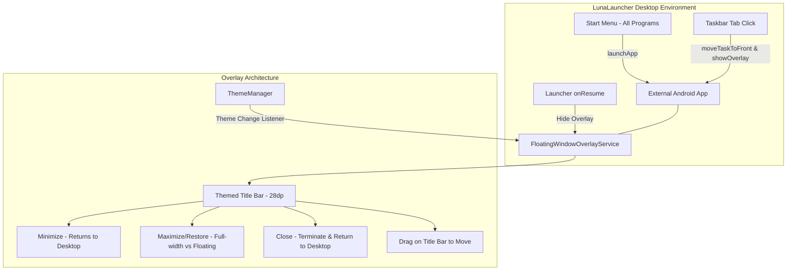

# Universal Windows Frame for Android Applications Implementation Plan

> **For agentic workers:** REQUIRED SUB-SKILL: Use superpowers:subagent-driven-development to implement this plan task-by-task. Steps use checkbox (`- [ ]`) syntax for tracking.

**Goal:** Give an authentic, moveable, minimizable, maximizable, and closable Windows XP window frame to all external Android apps present on the device, integrated with the taskbar and active theme engine.

**Architecture:** 
- An enhanced `FloatingWindowOverlayService` renders an authentic Windows title bar and frame (`TYPE_SYSTEM_ALERT`) over external applications.
- Dynamically loads real app icons and titles via `PackageManager`, styles the title bar according to `ThemeManager`, and provides Minimize, Maximize/Restore, and Close controls.
- `LauncherActivity` routes all external app launches and taskbar tab activations through `FloatingWindowOverlayService`, ensuring seamless desktop taskbar integration.

**Architecture Diagram:**

**Tech Stack:** Android KitKat 4.4.2 (API 19), Java, Android WindowManager (`TYPE_SYSTEM_ALERT`), Custom Layouts.

## Global Constraints
- Target device: Samsung Galaxy Tab 3 7.0 (`SM-T210`), Android 4.4.2 KitKat, API 19.
- Hardware resolution: 1024x600 landscape.
- Do NOT alter existing `WindowFrameView` UI/UX or any native apps (Explorer, WMP, Picture Viewer, Notepad, Paint, CMD, Control Panel).
- Evidence before claims: Verify all features with screenshots captured on hardware.

---

### Task 1: Enhance `FloatingWindowOverlayService`

**Files:**
- Modify: [`apps/LunaLauncher/src/com/windows/xp/launcher/service/FloatingWindowOverlayService.java`](file:///C:/Users/gohil/Downloads/Samsung_Tab3_SM-T210_Tools/WindowsXP_ROM_Project/apps/LunaLauncher/src/com/windows/xp/launcher/service/FloatingWindowOverlayService.java)

**Interfaces:**
- Consumes: `ThemeManager.getInstance().getTitlebarActiveRes()`, `PackageManager.getApplicationIcon()`, `PackageManager.getApplicationLabel()`
- Produces: Themed Windows title bar and movable floating frame for any running Android app.

- [ ] **Step 1: Implement authentic title bar, theme listener, and drag-to-move clamping**
  Update `createOverlayView()`, `applyThemeColors()`, and `setupButtonListeners()`:
  - Title bar height: 28dp matching `WindowFrameView`.
  - Icon: 18dp, real app icon.
  - Buttons: 21dp, `btn_min`, `btn_max`, `btn_close`.
  - In restored mode: `params.width = dpToPx(520)`, `params.height = dpToPx(340)`, bordered frame with `window_frame_border`.
  - Dragging updates `params.x` and `params.y` clamped to screen dimensions.

- [ ] **Step 2: Implement Minimize and Close handlers**
  - Minimize (`btnMin`): Starts `LauncherActivity` (`FLAG_ACTIVITY_REORDER_TO_FRONT`), hides overlay, leaves task in background.
  - Close (`btnClose`): Starts `LauncherActivity` (`FLAG_ACTIVITY_REORDER_TO_FRONT`), hides overlay, calls `activityManager.killBackgroundProcesses(packageName)`.

- [ ] **Step 3: Implement foreground watcher loop**
  - Add a lightweight runnable checking `activityManager.getRunningTasks(1)` every 1000ms:
    - If top task is an external app, ensure overlay is visible and updated.
    - If top task is `com.windows.xp.launcher`, hide overlay.

---

### Task 2: Integrate `LauncherActivity` External App Launching and Taskbar

**Files:**
- Modify: [`apps/LunaLauncher/src/com/windows/xp/launcher/LauncherActivity.java`](file:///C:/Users/gohil/Downloads/Samsung_Tab3_SM-T210_Tools/WindowsXP_ROM_Project/apps/LunaLauncher/src/com/windows/xp/launcher/LauncherActivity.java)

**Interfaces:**
- Consumes: `FloatingWindowOverlayService` intents (`EXTRA_PACKAGE_NAME`, `EXTRA_APP_LABEL`, `ACTION_CLOSE_OVERLAY`)
- Produces: Consistent external app launching with Windows frame across All Programs and Taskbar.

- [ ] **Step 1: Route All Programs installed app launches to `launchApp()`**
  In `populateAllProgramsList()`, update the click listener for `cachedInstalledApps` items to call `launchApp(app.packageName)` instead of bare `startActivity`.

- [ ] **Step 2: Update `launchApp(pkg)` to pass real application icon and label**
  In `launchApp(String pkg)`, extract the app label and launch intent, send intent to `FloatingWindowOverlayService`.

- [ ] **Step 3: Update Taskbar tab click listener**
  In `refreshTaskbarTabs()`, when user clicks an external taskbar tab, call `activityManager.moveTaskToFront(task.id, ...)` AND notify `FloatingWindowOverlayService`.

- [ ] **Step 4: Hide overlay on Launcher `onResume()`**
  In `onResume()`, send `ACTION_CLOSE_OVERLAY` to `FloatingWindowOverlayService` so the desktop remains clean.

---

### Task 3: Build & Deploy to Device

**Files:**
- Output: `apps/LunaLauncher.apk`

- [ ] **Step 1: Compile APK with `build_apk.sh`**
  Run: `wsl bash -c "cd tools && ./build_apk.sh ../apps/LunaLauncher ../apps/LunaLauncher.apk"`
  Expected: `Build successful` with exit code 0.

- [ ] **Step 2: Install APK onto Samsung Tab 3**
  Run: `..\platform-tools\adb.exe install -r apps/LunaLauncher.apk`
  Expected: `Success`.

---

### Task 4: Verify on Physical Device & Capture Evidence

- [ ] **Step 1: Launch an installed Android app (Space Cadet Pinball / S Voice / Calculator)**
  Verify the authentic Windows title bar appears on the app.

- [ ] **Step 2: Test Maximize / Restore and Dragging**
  Toggle restore mode, drag the window frame across the screen.

- [ ] **Step 3: Test Minimize to Taskbar**
  Tap Minimize button, verify desktop displays app tab on taskbar, click taskbar tab to restore.

- [ ] **Step 4: Test Close Application**
  Tap Close button, verify app closes and returns to desktop.

- [ ] **Step 5: Capture evidence screenshots**
  Capture live screenshots using `tools/capture_screen_wsl.py`.
