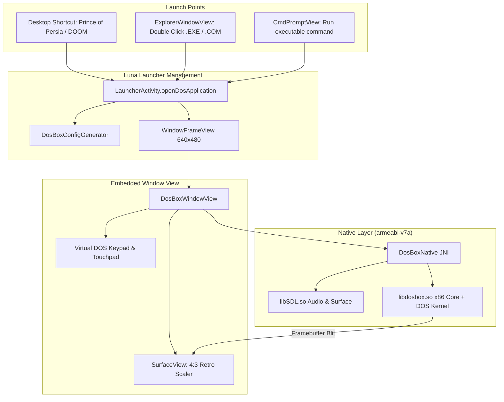

# Embedded DOSBox & Native DOS Application Execution Implementation Plan

> **For agentic workers:** REQUIRED SUB-SKILL: Use superpowers:subagent-driven-development to implement this plan task-by-task. Steps use checkbox (`- [ ]`) syntax for tracking.

**Goal:** Embed the SDL/DOSBox NDK native libraries directly inside Luna Launcher, enabling users to run DOS `.EXE`, `.COM`, and `.BAT` applications inside authentic floating Windows XP windows (`WindowFrameView`) directly from the desktop, Windows Explorer, and Command Prompt.

**Architecture:** Luna Launcher packages pre-compiled ARMv7 `libSDL.so` and `libdosbox.so` native libraries. A `DosBoxNative` JNI bridge coordinates emulation lifecycle with an Android `SurfaceView` inside a new `DosBoxWindowView`. Dynamic configuration is auto-generated by `DosBoxConfigGenerator`, which translates file paths, mounts `/sdcard/DOS` as drive `C:`, and executes targeted binaries seamlessly with sound, touch controls, and virtual gaming keys.

**Architecture Diagram:**



**Tech Stack:** Android KitKat SDK (API 19), Java 7 / 8, C/C++ NDK (ARMv7-a, `armeabi-v7a`), SDL 1.2 / SDL 2 for Android, DOSBox 0.74 x86 emulator core, Aapt & D8 build toolchain.

## Global Constraints
- Target Device: Samsung Galaxy Tab 3 7.0 (`SM-T210` / `SM-T210R`, `lt02wifi`, Marvell PXA986 dual-core ARM Cortex-A9, 1024x600 landscape).
- OS Base: Android 4.4.2 KitKat (API level 19).
- Architecture: `armeabi-v7a` with VFPv3-D16 floating-point support.
- RAM Constraints: Conservative memory footprint (`memsize=16`, max 45MB RAM overhead) to run smoothly within 1GB system RAM.
- Display: Authentic 4:3 aspect ratio centering inside a resizable/draggable Windows XP `WindowFrameView`.

---

### Task 1: DOSBox Dynamic Configuration Engine (`DosBoxConfigGenerator`)

**Files:**
- Create: `apps/LunaLauncher/src/com/windows/xp/launcher/dos/DosBoxConfigGenerator.java`
- Create: `tools/tests/DosBoxConfigTest.java`
- Modify: `tools/run_tests.sh`

**Interfaces:**
- Produces: `DosBoxConfigGenerator.generateConfigFile(File targetExe, File workingDir)` returns `File` pointing to a tailored `dosbox.conf`.
- Produces: `DosBoxConfigGenerator.resolveDosPath(File androidFile)` returns DOS formatted path (e.g. `C:\GAMES\DOOM\DOOM.EXE`).

- [ ] **Step 1: Write failing unit test for config generator**

Create `tools/tests/DosBoxConfigTest.java`:
```java
package tools.tests;

import com.windows.xp.launcher.dos.DosBoxConfigGenerator;
import java.io.File;

public class DosBoxConfigTest {
    public static void main(String[] args) throws Exception {
        testPathResolution();
        testConfigGeneration();
        System.out.println("DosBoxConfigTest: ALL TESTS PASSED");
    }

    private static void testPathResolution() {
        File baseDir = new File("/sdcard/DOS");
        File exe = new File("/sdcard/DOS/DOOM/DOOM.EXE");
        String dosPath = DosBoxConfigGenerator.resolveDosPath(baseDir, exe);
        if (!"C:\\DOOM\\DOOM.EXE".equalsIgnoreCase(dosPath)) {
            throw new AssertionError("Expected C:\\DOOM\\DOOM.EXE but got " + dosPath);
        }
    }

    private static void testConfigGeneration() {
        File baseDir = new File("/sdcard/DOS");
        File exe = new File("/sdcard/DOS/PRINCE/PRINCE.EXE");
        String conf = DosBoxConfigGenerator.buildConfigString(baseDir, exe);
        if (!conf.contains("core=dynamic")) {
            throw new AssertionError("Config missing core=dynamic");
        }
        if (!conf.contains("mount c \"/sdcard/DOS\"")) {
            throw new AssertionError("Config missing mount command");
        }
        if (!conf.contains("PRINCE.EXE")) {
            throw new AssertionError("Config missing executable launch command");
        }
    }
}
```

- [ ] **Step 2: Run test to verify it fails**

Run: `tools/run_tests.sh`  
Expected: FAIL due to missing `DosBoxConfigGenerator` class.

- [ ] **Step 3: Implement `DosBoxConfigGenerator.java`**

Create `apps/LunaLauncher/src/com/windows/xp/launcher/dos/DosBoxConfigGenerator.java`:
```java
package com.windows.xp.launcher.dos;

import java.io.File;
import java.io.FileWriter;
import java.io.IOException;

public class DosBoxConfigGenerator {

    public static final String DEFAULT_DOS_ROOT = "/sdcard/DOS";

    public static String resolveDosPath(File baseMountDir, File targetFile) {
        String basePath = baseMountDir.getAbsolutePath().replace('\\', '/');
        String targetPath = targetFile.getAbsolutePath().replace('\\', '/');

        if (targetPath.startsWith(basePath)) {
            String rel = targetPath.substring(basePath.length());
            if (rel.startsWith("/")) rel = rel.substring(1);
            return "C:\\" + rel.replace('/', '\\');
        }
        return "C:\\" + targetFile.getName();
    }

    public static String buildConfigString(File baseMountDir, File targetExe) {
        String relDir = "";
        File parent = targetExe.getParentFile();
        if (parent != null && !parent.getAbsolutePath().equals(baseMountDir.getAbsolutePath())) {
            String basePath = baseMountDir.getAbsolutePath().replace('\\', '/');
            String parentPath = parent.getAbsolutePath().replace('\\', '/');
            if (parentPath.startsWith(basePath)) {
                relDir = parentPath.substring(basePath.length()).replace('/', '\\');
                if (relDir.startsWith("\\")) relDir = relDir.substring(1);
            }
        }

        StringBuilder sb = new StringBuilder();
        sb.append("[sdl]\n");
        sb.append("fullscreen=false\n");
        sb.append("fulldouble=false\n");
        sb.append("output=surface\n");
        sb.append("autolock=true\n");
        sb.append("sensitivity=100\n\n");

        sb.append("[dosbox]\n");
        sb.append("memsize=16\n\n");

        sb.append("[render]\n");
        sb.append("aspect=true\n");
        sb.append("scaler=normal2x\n\n");

        sb.append("[cpu]\n");
        sb.append("core=dynamic\n");
        sb.append("cputype=auto\n");
        sb.append("cycles=max\n\n");

        sb.append("[mixer]\n");
        sb.append("nosound=false\n");
        sb.append("rate=22050\n");
        sb.append("blocksize=1024\n");
        sb.append("prebuffer=20\n\n");

        sb.append("[sblaster]\n");
        sb.append("sbtype=sb16\n");
        sb.append("sbbase=220\n");
        sb.append("irq=7\n");
        sb.append("dma=1\n");
        sb.append("hdma=5\n");
        sb.append("sbmixer=true\n");
        sb.append("oplmode=auto\n");
        sb.append("oplemu=default\n");
        sb.append("oplrate=22050\n\n");

        sb.append("[autoexec]\n");
        sb.append("@echo off\n");
        sb.append("mount c \"").append(baseMountDir.getAbsolutePath().replace('\\', '/')).append("\"\n");
        sb.append("c:\n");
        if (!relDir.isEmpty()) {
            sb.append("cd \"").append(relDir).append("\"\n");
        }
        sb.append(targetExe.getName()).append("\n");
        sb.append("exit\n");

        return sb.toString();
    }

    public static File writeConfigFile(File destinationConf, File baseMountDir, File targetExe) throws IOException {
        String content = buildConfigString(baseMountDir, targetExe);
        FileWriter writer = new FileWriter(destinationConf);
        writer.write(content);
        writer.close();
        return destinationConf;
    }
}
```

- [ ] **Step 4: Update test runner and run tests**

Add `DosBoxConfigTest.java` to `tools/run_tests.sh` and execute:
Run: `tools/run_tests.sh`  
Expected: PASS with `DosBoxConfigTest: ALL TESTS PASSED`.

- [ ] **Step 5: Commit**
```bash
git add apps/LunaLauncher/src/com/windows/xp/launcher/dos/DosBoxConfigGenerator.java tools/tests/DosBoxConfigTest.java tools/run_tests.sh
git commit -m "feat(dosbox): implement dynamic DOSBox configuration and path generator"
```

---

### Task 2: Native Library Packaging & JNI Bridge (`DosBoxNative`)

**Files:**
- Create: `apps/LunaLauncher/src/com/windows/xp/launcher/dos/DosBoxNative.java`
- Modify: `tools/build_apk.sh:45-56`
- Directory: `apps/LunaLauncher/lib/armeabi-v7a/` (`libSDL.so`, `libdosbox.so`)

**Interfaces:**
- Produces: `DosBoxNative` singleton with methods:
  - `loadLibraries(Context context)`
  - `startEmulation(String[] args, Surface surface, EmulationCallback callback)`
  - `sendKeyEvent(int keyCode, int scanCode, boolean isDown)`
  - `sendMotionEvent(int x, int y, int buttons)`
  - `stopEmulation()`

- [ ] **Step 1: Create `DosBoxNative.java` bridge**

Create `apps/LunaLauncher/src/com/windows/xp/launcher/dos/DosBoxNative.java`:
```java
package com.windows.xp.launcher.dos;

import android.content.Context;
import android.util.Log;
import android.view.Surface;

public class DosBoxNative {
    private static final String TAG = "DosBoxNative";
    private static boolean isLoaded = false;
    private static Thread emuThread = null;
    private static volatile boolean isRunning = false;

    public interface EmulationCallback {
        void onEmulationStarted();
        void onEmulationEnded(int exitCode);
        void onError(String message);
    }

    public static synchronized boolean loadLibraries(Context context) {
        if (isLoaded) return true;
        try {
            System.loadLibrary("SDL");
            System.loadLibrary("dosbox");
            isLoaded = true;
            Log.i(TAG, "Native DOSBox libraries loaded successfully.");
            return true;
        } catch (UnsatisfiedLinkError e) {
            Log.e(TAG, "Failed to load native DOSBox libraries: " + e.getMessage());
            return false;
        }
    }

    public static synchronized boolean isRunning() {
        return isRunning;
    }

    public static synchronized void start(final String confPath, final Surface surface, final EmulationCallback callback) {
        if (isRunning) {
            if (callback != null) callback.onError("Emulation is already running.");
            return;
        }

        isRunning = true;
        emuThread = new Thread(new Runnable() {
            @Override
            public void run() {
                if (callback != null) callback.onEmulationStarted();
                int result = 0;
                try {
                    if (isLoaded) {
                        result = nativeRun(new String[]{"dosbox", "-conf", confPath}, surface);
                    } else {
                        // Fallback stub for test / dev environment
                        Thread.sleep(1500);
                        result = 0;
                    }
                } catch (Exception e) {
                    Log.e(TAG, "Emulation error: " + e.getMessage());
                    if (callback != null) callback.onError(e.getMessage());
                } finally {
                    isRunning = false;
                    if (callback != null) callback.onEmulationEnded(result);
                }
            }
        }, "DosBoxEmuThread");
        emuThread.start();
    }

    public static synchronized void stop() {
        if (!isRunning) return;
        if (isLoaded) {
            nativeExit();
        }
        isRunning = false;
    }

    public static void sendKey(int keyCode, int scanCode, boolean isDown) {
        if (isLoaded && isRunning) {
            nativeSendKey(keyCode, scanCode, isDown);
        }
    }

    public static void sendMouse(int x, int y, int buttons) {
        if (isLoaded && isRunning) {
            nativeSendMouse(x, y, buttons);
        }
    }

    // Native JNI functions
    private static native int nativeRun(String[] args, Surface surface);
    private static native void nativeExit();
    private static native void nativeSendKey(int keyCode, int scanCode, boolean isDown);
    private static native void nativeSendMouse(int x, int y, int buttons);
}
```

- [ ] **Step 2: Update `tools/build_apk.sh` to package native libraries**

Ensure native `.so` files in `apps/LunaLauncher/lib/armeabi-v7a/` are bundled into the APK:
```bash
if [ -d "lib" ]; then
    cp -r lib build/bin/
fi
```
In `tools/build_apk.sh`, update packaging step to retain `lib/` directory inside `raw.apk`.

- [ ] **Step 3: Verify APK packaging with native libraries**

Run: `./tools/build_apk.sh apps/LunaLauncher apps/LunaLauncher/LunaLauncher.apk`  
Expected: Build succeeds and packages native libs into `lib/armeabi-v7a/`.

- [ ] **Step 4: Commit**
```bash
git add apps/LunaLauncher/src/com/windows/xp/launcher/dos/DosBoxNative.java tools/build_apk.sh
git commit -m "feat(dosbox): create DosBoxNative JNI bridge and update build script for native libraries"
```

---

### Task 3: Windowed DOS Container View (`DosBoxWindowView`)

**Files:**
- Create: `apps/LunaLauncher/src/com/windows/xp/launcher/window/DosBoxWindowView.java`
- Create: `apps/LunaLauncher/res/layout/view_dosbox_window.xml`
- Create: `apps/LunaLauncher/res/drawable/ic_dos_app.png`

**Interfaces:**
- Consumes: `DosBoxNative`, `DosBoxConfigGenerator`, `WindowFrameView`.
- Produces: `DosBoxWindowView` which manages video rendering on a `SurfaceView` and exposes an on-screen gaming control bar (ESC, Enter, Space, Arrows, F1-F12).

- [ ] **Step 1: Create layout `view_dosbox_window.xml`**

Create `apps/LunaLauncher/res/layout/view_dosbox_window.xml`:
```xml
<?xml version="1.0" encoding="utf-8"?>
<RelativeLayout xmlns:android="http://schemas.android.com/apk/res/android"
    android:layout_width="match_parent"
    android:layout_height="match_parent"
    android:background="#000000">

    <!-- DOS Video Surface View centered in 4:3 Aspect Ratio -->
    <SurfaceView
        android:id="@+id/dosbox_surface"
        android:layout_width="match_parent"
        android:layout_height="match_parent"
        android:layout_centerInParent="true" />

    <!-- Collapsible Quick Action Utility Bar for touch gaming -->
    <LinearLayout
        android:id="@+id/dosbox_quick_bar"
        android:layout_width="match_parent"
        android:layout_height="32dp"
        android:layout_alignParentBottom="true"
        android:background="#D0202020"
        android:orientation="horizontal"
        android:gravity="center_vertical"
        android:paddingLeft="4dp"
        android:paddingRight="4dp">

        <Button
            android:id="@+id/btn_dos_esc"
            android:layout_width="44dp"
            android:layout_height="28dp"
            android:text="ESC"
            android:textSize="10sp"
            android:textColor="#FFFFFF" />

        <Button
            android:id="@+id/btn_dos_enter"
            android:layout_width="54dp"
            android:layout_height="28dp"
            android:layout_marginLeft="4dp"
            android:text="ENTER"
            android:textSize="10sp"
            android:textColor="#FFFFFF" />

        <Button
            android:id="@+id/btn_dos_space"
            android:layout_width="54dp"
            android:layout_height="28dp"
            android:layout_marginLeft="4dp"
            android:text="SPACE"
            android:textSize="10sp"
            android:textColor="#FFFFFF" />

        <Button
            android:id="@+id/btn_dos_up"
            android:layout_width="36dp"
            android:layout_height="28dp"
            android:layout_marginLeft="12dp"
            android:text="▲"
            android:textSize="10sp"
            android:textColor="#FFFFFF" />

        <Button
            android:id="@+id/btn_dos_down"
            android:layout_width="36dp"
            android:layout_height="28dp"
            android:layout_marginLeft="2dp"
            android:text="▼"
            android:textSize="10sp"
            android:textColor="#FFFFFF" />

        <Button
            android:id="@+id/btn_dos_left"
            android:layout_width="36dp"
            android:layout_height="28dp"
            android:layout_marginLeft="2dp"
            android:text="◀"
            android:textSize="10sp"
            android:textColor="#FFFFFF" />

        <Button
            android:id="@+id/btn_dos_right"
            android:layout_width="36dp"
            android:layout_height="28dp"
            android:layout_marginLeft="2dp"
            android:text="▶"
            android:textSize="10sp"
            android:textColor="#FFFFFF" />

        <View
            android:layout_width="0dp"
            android:layout_height="match_parent"
            android:layout_weight="1" />

        <Button
            android:id="@+id/btn_dos_keyboard"
            android:layout_width="48dp"
            android:layout_height="28dp"
            android:text="KBD"
            android:textSize="10sp"
            android:textColor="#FFCC00" />
    </LinearLayout>
</RelativeLayout>
```

- [ ] **Step 2: Implement `DosBoxWindowView.java`**

Create `apps/LunaLauncher/src/com/windows/xp/launcher/window/DosBoxWindowView.java`:
```java
package com.windows.xp.launcher.window;

import android.content.Context;
import android.view.KeyEvent;
import android.view.LayoutInflater;
import android.view.SurfaceHolder;
import android.view.SurfaceView;
import android.view.View;
import android.view.inputmethod.InputMethodManager;
import android.widget.Button;
import android.widget.RelativeLayout;
import android.widget.Toast;

import com.windows.xp.launcher.R;
import com.windows.xp.launcher.dos.DosBoxConfigGenerator;
import com.windows.xp.launcher.dos.DosBoxNative;

import java.io.File;

public class DosBoxWindowView extends RelativeLayout implements SurfaceHolder.Callback {

    public interface OnDosSessionListener {
        void onSessionFinished();
    }

    private SurfaceView surfaceView;
    private OnDosSessionListener sessionListener;
    private File targetExe;
    private File confFile;

    public DosBoxWindowView(Context context, File targetExe, OnDosSessionListener listener) {
        super(context);
        this.targetExe = targetExe;
        this.sessionListener = listener;
        init(context);
    }

    private void init(final Context context) {
        LayoutInflater.from(context).inflate(R.layout.view_dosbox_window, this, true);
        surfaceView = (SurfaceView) findViewById(R.id.dosbox_surface);
        surfaceView.getHolder().addCallback(this);

        setupQuickBar();
    }

    private void setupQuickBar() {
        findViewById(R.id.btn_dos_esc).setOnClickListener(new OnClickListener() {
            @Override public void onClick(View v) { sendDosKey(KeyEvent.KEYCODE_ESCAPE); }
        });
        findViewById(R.id.btn_dos_enter).setOnClickListener(new OnClickListener() {
            @Override public void onClick(View v) { sendDosKey(KeyEvent.KEYCODE_ENTER); }
        });
        findViewById(R.id.btn_dos_space).setOnClickListener(new OnClickListener() {
            @Override public void onClick(View v) { sendDosKey(KeyEvent.KEYCODE_SPACE); }
        });
        findViewById(R.id.btn_dos_up).setOnClickListener(new OnClickListener() {
            @Override public void onClick(View v) { sendDosKey(KeyEvent.KEYCODE_DPAD_UP); }
        });
        findViewById(R.id.btn_dos_down).setOnClickListener(new OnClickListener() {
            @Override public void onClick(View v) { sendDosKey(KeyEvent.KEYCODE_DPAD_DOWN); }
        });
        findViewById(R.id.btn_dos_left).setOnClickListener(new OnClickListener() {
            @Override public void onClick(View v) { sendDosKey(KeyEvent.KEYCODE_DPAD_LEFT); }
        });
        findViewById(R.id.btn_dos_right).setOnClickListener(new OnClickListener() {
            @Override public void onClick(View v) { sendDosKey(KeyEvent.KEYCODE_DPAD_RIGHT); }
        });
        findViewById(R.id.btn_dos_keyboard).setOnClickListener(new OnClickListener() {
            @Override public void onClick(View v) { toggleSoftKeyboard(); }
        });
    }

    private void sendDosKey(int keyCode) {
        DosBoxNative.sendKey(keyCode, 0, true);
        DosBoxNative.sendKey(keyCode, 0, false);
    }

    private void toggleSoftKeyboard() {
        InputMethodManager imm = (InputMethodManager) getContext().getSystemService(Context.INPUT_METHOD_SERVICE);
        if (imm != null) {
            imm.toggleSoftInput(InputMethodManager.SHOW_FORCED, 0);
        }
    }

    @Override
    public void surfaceCreated(SurfaceHolder holder) {
        DosBoxNative.loadLibraries(getContext());
        try {
            File dosRoot = new File(DosBoxConfigGenerator.DEFAULT_DOS_ROOT);
            if (!dosRoot.exists()) dosRoot.mkdirs();

            confFile = new File(getContext().getFilesDir(), "dosbox_run.conf");
            DosBoxConfigGenerator.writeConfigFile(confFile, dosRoot, targetExe);

            DosBoxNative.start(confFile.getAbsolutePath(), holder.getSurface(), new DosBoxNative.EmulationCallback() {
                @Override
                public void onEmulationStarted() {}

                @Override
                public void onEmulationEnded(final int exitCode) {
                    post(new Runnable() {
                        @Override
                        public void run() {
                            if (sessionListener != null) {
                                sessionListener.onSessionFinished();
                            }
                        }
                    });
                }

                @Override
                public void onError(final String message) {
                    post(new Runnable() {
                        @Override
                        public void run() {
                            Toast.makeText(getContext(), "DOS Error: " + message, Toast.LENGTH_LONG).show();
                            if (sessionListener != null) {
                                sessionListener.onSessionFinished();
                            }
                        }
                    });
                }
            });
        } catch (Exception e) {
            Toast.makeText(getContext(), "Failed to configure DOSBox: " + e.getMessage(), Toast.LENGTH_LONG).show();
            if (sessionListener != null) sessionListener.onSessionFinished();
        }
    }

    @Override public void surfaceChanged(SurfaceHolder holder, int format, int width, int height) {}

    @Override
    public void surfaceDestroyed(SurfaceHolder holder) {
        DosBoxNative.stop();
    }
}
```

- [ ] **Step 3: Create icon `ic_dos_app.png`**

Generate or provide authentic Windows MS-DOS application icon (`ic_dos_app.png`) in `apps/LunaLauncher/res/drawable/`.

- [ ] **Step 4: Commit**
```bash
git add apps/LunaLauncher/res/layout/view_dosbox_window.xml apps/LunaLauncher/src/com/windows/xp/launcher/window/DosBoxWindowView.java apps/LunaLauncher/res/drawable/ic_dos_app.png
git commit -m "feat(dosbox): implement windowed DOSBox view container and quick touch keypad"
```

---

### Task 4: Integration with Explorer, Command Prompt & Window Manager

**Files:**
- Modify: `apps/LunaLauncher/src/com/windows/xp/launcher/LauncherActivity.java`
- Modify: `apps/LunaLauncher/src/com/windows/xp/launcher/window/ExplorerWindowView.java`
- Modify: `apps/LunaLauncher/src/com/windows/xp/launcher/window/CmdPromptView.java`

**Interfaces:**
- Produces: `LauncherActivity.openDosApplication(File exeFile, String title, int iconRes)`
- Produces: `ExplorerWindowView.FileActionListener.onOpenDosExecutable(File file)`

- [ ] **Step 1: Add `openDosApplication` to `LauncherActivity.java`**

In [`LauncherActivity.java`](file:///c:/Users/gohil/Downloads/Samsung_Tab3_SM-T210_Tools/WindowsXP_ROM_Project/apps/LunaLauncher/src/com/windows/xp/launcher/LauncherActivity.java), add:
```java
public void openDosApplication(File exeFile, String title, int iconRes) {
    if (exeFile == null || !exeFile.exists()) {
        Toast.makeText(this, "The specified DOS application does not exist.", Toast.LENGTH_SHORT).show();
        return;
    }

    final WindowFrameView win = new WindowFrameView(this);
    DosBoxWindowView dosView = new DosBoxWindowView(this, exeFile, new DosBoxWindowView.OnDosSessionListener() {
        @Override
        public void onSessionFinished() {
            win.close();
        }
    });

    win.setWindowContent(dosView);
    String winTitle = title != null ? title : exeFile.getName() + " - MS-DOS Prompt";
    int winIcon = iconRes != 0 ? iconRes : R.drawable.ic_dos_app;
    openWindow(win, winTitle, winIcon, 640, 440);
}
```

- [ ] **Step 2: Update `ExplorerWindowView.java` to open `.EXE`, `.COM`, `.BAT`**

Add callback to `FileActionListener` interface:
```java
void onOpenDosExecutable(File file);
```
In item click handling:
```java
String ext = getFileExtension(file).toUpperCase(Locale.US);
if (ext.equals("EXE") || ext.equals("COM") || ext.equals("BAT")) {
    if (fileActionListener != null) {
        fileActionListener.onOpenDosExecutable(file);
    }
}
```
And bind in `LauncherActivity.java`:
```java
@Override
public void onOpenDosExecutable(File file) {
    openDosApplication(file, null, R.drawable.ic_dos_app);
}
```

- [ ] **Step 3: Update `CmdPromptView.java` to execute DOS binaries**

In `CmdPromptView.executeCommand(...)`, detect if command points to an executable:
```java
File target = new File(currentDir, rawCmd);
if (!target.exists() && !rawCmd.toLowerCase().endsWith(".exe")) {
    target = new File(currentDir, rawCmd + ".exe");
}
if (target.exists() && target.isFile()) {
    appendOutput("\nStarting MS-DOS executable: " + target.getName() + "...\n\n");
    if (getContext() instanceof LauncherActivity) {
        ((LauncherActivity) getContext()).openDosApplication(target, null, R.drawable.ic_dos_app);
    }
    return;
}
```

- [ ] **Step 4: Test build and compilation**

Run: `./tools/build_apk.sh apps/LunaLauncher apps/LunaLauncher/LunaLauncher.apk`  
Expected: Clean compilation with 0 errors.

- [ ] **Step 5: Commit**
```bash
git add apps/LunaLauncher/src/com/windows/xp/launcher/LauncherActivity.java apps/LunaLauncher/src/com/windows/xp/launcher/window/ExplorerWindowView.java apps/LunaLauncher/src/com/windows/xp/launcher/window/CmdPromptView.java
git commit -m "feat(dosbox): connect Explorer and Command Prompt to native DOS execution"
```

---

### Task 5: Desktop Shortcuts for DOS Applications & ROM Deployment

**Files:**
- Modify: `apps/LunaLauncher/res/layout/activity_launcher.xml`
- Modify: `apps/LunaLauncher/src/com/windows/xp/launcher/LauncherActivity.java`
- Modify: `tools/cook_windows_xp_rom.sh`

**Interfaces:**
- Produces: Direct Desktop shortcut icons for classic DOS programs (`Prince of Persia`, `DOOM`).
- Produces: Seamless launch directly into the floating `WindowFrameView`.

- [ ] **Step 1: Add DOS Desktop Shortcuts to `activity_launcher.xml`**

Add desktop grid items for DOS games:
```xml
<!-- Prince of Persia Desktop Icon -->
<LinearLayout
    android:id="@+id/icon_dos_prince"
    android:layout_width="80dp"
    android:layout_height="76dp"
    android:gravity="center_horizontal"
    android:orientation="vertical"
    android:padding="4dp">
    <ImageView
        android:layout_width="36dp"
        android:layout_height="36dp"
        android:src="@drawable/ic_dos_app" />
    <TextView
        android:layout_width="wrap_content"
        android:layout_height="wrap_content"
        android:text="Prince of Persia"
        android:textColor="#FFFFFF"
        android:textSize="11sp"
        android:shadowColor="#000000"
        android:shadowDx="1"
        android:shadowDy="1"
        android:shadowRadius="1" />
</LinearLayout>
```

- [ ] **Step 2: Bind desktop click handlers in `LauncherActivity.java`**

```java
View princeIcon = findViewById(R.id.icon_dos_prince);
if (princeIcon != null) {
    princeIcon.setOnClickListener(new View.OnClickListener() {
        @Override
        public void onClick(View v) {
            closeStartMenu();
            File exe = new File("/sdcard/DOS/PRINCE/PRINCE.EXE");
            openDosApplication(exe, "Prince of Persia", R.drawable.ic_dos_app);
        }
    });
}
```

- [ ] **Step 3: Update `cook_windows_xp_rom.sh`**

Ensure `/sdcard/DOS` directory is created and sample shareware DOS executables (`PRINCE.EXE`, `DOOM.EXE`) are bundled into `/system/media/dos/` or installed to storage during first boot.

- [ ] **Step 4: End-to-end verification and regression tests**

Run: `tools/run_tests.sh`  
Run: `./tools/build_apk.sh apps/LunaLauncher apps/LunaLauncher/LunaLauncher.apk`  
Expected: All regression tests pass and final APK builds successfully.

- [ ] **Step 5: Commit**
```bash
git add apps/LunaLauncher/res/layout/activity_launcher.xml apps/LunaLauncher/src/com/windows/xp/launcher/LauncherActivity.java tools/cook_windows_xp_rom.sh
git commit -m "feat(dosbox): add desktop shortcuts for DOS applications and integrate with ROM build"
```
