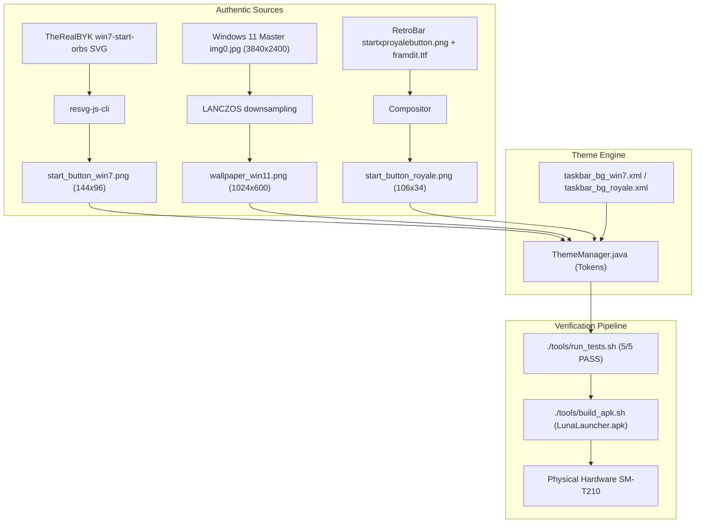

# Theme Asset Corrections Implementation Plan

> **For agentic workers:** REQUIRED SUB-SKILL: Use superpowers:subagent-driven-development to implement this plan task-by-task. Steps use checkbox (`- [ ]`) syntax for tracking.

**Goal:** Integrate authentic high-resolution assets for Windows 7 (3D Aero Start Orb and Aero Glass taskbar), Windows 11 (clean unblemished Bloom wallpaper without desktop icons/UI), and Windows XP Royale (authentic emerald green Start button, Energy Blue taskbar, and royal blue window borders).

**Architecture:** Update `tools/generate_theme_assets.py` to deterministically produce authentic bitmaps from upstream vector/master assets, update XML drawables for Aero Glass and Energy Blue taskbars, update `ThemeManager.java` color tokens, and enforce zero regressions via the automated test suite before APK compilation and hardware verification.

**Architecture Diagram:**

**Tech Stack:** Java 7 / Android API 19 (KitKat 4.4.2), Python 3.10 with Pillow, Rust resvg-js-cli, Linux WSL, ADB.

## Global Constraints

- Android API 19 (KitKat 4.4.2) compatibility for all Java code and drawables.
- Wallpapers must be pristine (no baked-in desktop icons or Start Menu).
- The automated test suite (`./tools/run_tests.sh`) must pass 5/5 before every commit and build.
- Maintain LF line endings in all text files.

---

### Task 1: Generate & Replace Authentic Drawables & Bitmaps

**Files:**
- Modify: `tools/generate_theme_assets.py`
- Output Bitmaps:
  - `apps/LunaLauncher/res/drawable/start_button_win7.png`
  - `apps/LunaLauncher/res/drawable/wallpaper_win11.png`
  - `apps/LunaLauncher/res/drawable/start_button_royale.png`
- Modify XMLs:
  - `apps/LunaLauncher/res/drawable/taskbar_bg_win7.xml`
  - `apps/LunaLauncher/res/drawable/tray_bg_win7.xml`
  - `apps/LunaLauncher/res/drawable/taskbar_bg_royale.xml`
  - `apps/LunaLauncher/res/drawable/tray_bg_royale.xml`

**Interfaces:**
- Produces: Authentic drawables referenced by `ThemeManager.java`.

- [ ] **Step 1: Update `tools/generate_theme_assets.py` to generate authentic assets**
  - Use `win7_orb_256.png` centered in 144x96px canvas (48x32dp at 3x) with 31dp orb diameter to maintain 1:1 circle.
  - Crop and downsample `C:\Windows\Web\Wallpaper\Windows\img0.jpg` to clean 1024x600 for `wallpaper_win11.png`.
  - Composite `startxproyalebutton.png` slice, `ic_turn_off_header_flag.png`, and Franklin Gothic Medium Italic "start" text for `start_button_royale.png`.
- [ ] **Step 2: Update XML taskbars and tray drawables**
  - Update `taskbar_bg_win7.xml` to translucent Aero Glass `#3B74A8` -> `#2B5885` -> `#1C4166` with specular stroke `#76AEE0`.
  - Update `taskbar_bg_royale.xml` to Energy Blue layer-list with top specular line `#99C6F1` and gradient `#5896DF` -> `#397DD0` -> `#254394`.
  - Update `tray_bg_royale.xml` with dark royal blue gradient `#204A9C` -> `#102C66` and stroke `#456DAC`.
- [ ] **Step 3: Run generator script and verify outputs**
  - Run `python tools/generate_theme_assets.py`. Verify all 3 PNGs are produced with non-zero sizes.
- [ ] **Step 4: Commit assets**
  - Commit message: `feat(theme): add authentic Windows 7 Start Orb, clean Win11 Bloom wallpaper, and Royale assets`

---

### Task 2: ThemeManager & DisplayProperties Color Alignments (TDD)

**Files:**
- Modify: `tools/tests/ThemeManagerTest.java`
- Modify: `apps/LunaLauncher/src/com/windows/xp/launcher/theme/ThemeManager.java`
- Modify: `apps/LunaLauncher/src/com/windows/xp/launcher/window/DisplayPropertiesWindowView.java`

**Interfaces:**
- Consumes: Drawables from Task 1.
- Produces: Verified `ThemeManager` tokens for Royale and Windows 7.

- [ ] **Step 1: Write failing test assertions in `tools/tests/ThemeManagerTest.java`**
  - Assert `getTitlebarActiveStart(ROYALE) == 0xFF2E62D4`.
  - Assert `getTitlebarActiveEnd(ROYALE) == 0xFF6894EE`.
  - Assert `getWindowBorderColor(ROYALE) == 0xFF004BAA`.
- [ ] **Step 2: Run test to verify failure**
  - Run: `./tools/run_tests.sh` in WSL.
  - Expected: Fails on Royale color assertions.
- [ ] **Step 3: Implement minimal token updates in `ThemeManager.java` & `DisplayPropertiesWindowView.java`**
  - Update Royale tokens in `ThemeManager.java`.
  - Update CRT preview colors in `DisplayPropertiesWindowView.java`.
- [ ] **Step 4: Run test to verify passes**
  - Run: `./tools/run_tests.sh` in WSL.
  - Expected: 5/5 tests PASS.
- [ ] **Step 5: Commit changes**
  - Commit message: `feat(theme): update Royale titlebar and border color tokens and synchronize CRT preview`

---

### Task 3: Build APK & Physical Hardware Verification

**Files:**
- Test script: `tools/build_apk.sh`
- Artifact: `LunaLauncher.apk`

- [ ] **Step 1: Compile APK**
  - Run `./tools/build_apk.sh apps/LunaLauncher LunaLauncher.apk` in WSL.
  - Verify automated regression tests run and exit code is 0.
- [ ] **Step 2: Deploy to Samsung Galaxy Tab 3 via ADB**
  - Install `LunaLauncher.apk` onto `41007d269000b000`.
- [ ] **Step 3: Visual Verification on Hardware**
  - Switch to Windows 7 theme -> capture `verify_win7_fixed.png`.
  - Switch to Windows 11 theme -> capture `verify_win11_clean_wall.png`.
  - Switch to Royale theme -> capture `verify_royale_fixed.png`.
  - Confirm authentic appearance with zero defects.

---

### Task 4: Whole-Branch Review & Clean Merge into Master

- [ ] **Step 1: Dispatch subagent code review**
  - Verify entire branch diff against `master`.
- [ ] **Step 2: Merge into `master`**
  - Merge `feat/fix-theme-assets-win7-royale-win11` into `master`.
