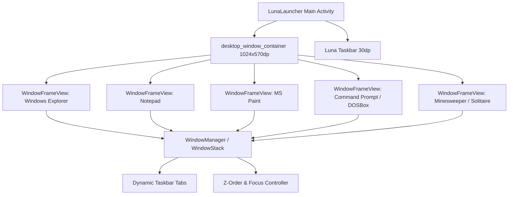

# Design Specification: Windows XP Windowed Desktop Manager, Authentic Icons & DOSBox Command Prompt

## 1. Overview & Goals
Phase C elevates the Windows XP Luna transformation on the Samsung Galaxy Tab 3 7.0 (SM-T210 / SM-T210R, Android KitKat 4.4.2) into a true desktop multitasking environment. 

### Core Goals:
1. **Multi-Window Floating Desktop**: Turn `LunaLauncher` into a desktop window manager where native applications (Notepad, MS Paint, Windows Explorer, Command Prompt, Minesweeper, Solitaire, Media Player) run inside movable, resizable, floating `WindowFrameView` containers simultaneously.
2. **Authentic Window Controls**: Classic Luna title bar with 16x16 icon, bold white title, Minimize (`_`), Maximize/Restore (`□` / `❐`), and Close (`X`) buttons. Support dragging to move, corner resizing, active/inactive focus styling, and taskbar tab synchronization.
3. **Dual-Mode Command Prompt & DOSBox (`cmd.exe`)**: A native black console window with classic XP prompt `C:\Documents and Settings\Administrator>`, built-in DOS commands (`DIR`, `CD`, `CLS`, `TYPE`, `COPY`, `DEL`, `VER`, `HELP`, `EXIT`), Android shell execution bridge, and integrated `DOSBOX` runner.
4. **Authentic Windows XP Icon Suite**: Full system-wide upgrade with authentic 32-bit alpha-blended Windows XP icons (My Computer, My Documents, Folders, Hard Drive C:, CD Drive D:, Paint, Notepad, Command Prompt, IE, WMP, Games, Recycle Bin).

---

## 2. System Architecture



### 2.1 Window Management Framework (`com.windows.xp.launcher.window`)

1. **`WindowFrameView`**:
   - Extends `RelativeLayout`.
   - Dimensions & Positioning: Defaults to floating geometry (width: ~680dp, height: ~440dp, x: 80dp, y: 40dp, cascading offset for subsequent windows).
   - Outer Border: 3px Windows XP Luna border (`#00138C` outer border, `#0055EA` inner stroke).
   - Shadow & Elevation: Soft 4px outer drop-shadow.

2. **Title Bar (`28dp` height)**:
   - Gradient background:
     - Active Window: Classic Luna blue gradient (`#0055EA` to `#00138C`).
     - Inactive Window: Classic muted gray-blue gradient (`#7A96DF` to `#5A70B2`).
   - Title Icon: Authentic 16x16 icon.
   - Title Label: Bold `Tahoma` white font with subtle text drop-shadow.
   - Button Controls (Right-aligned):
     - **Minimize (`_`)**: Hides window frame (`setVisibility(GONE)`) and marks taskbar tab inactive. Tapping the taskbar tab restores the window and brings it to the top.
     - **Maximize / Restore (`□` / `❐`)**: Toggles between stored floating bounds (`Rect floatingBounds`) and full desktop bounds (`1024x570dp` at `x=0, y=0`). Updates icon between `btn_max.png` and `btn_restore.png`.
     - **Close (`X`)**: Removes the view from `desktop_window_container`, recycles resources, and removes its taskbar tab.

3. **Touch Interaction & Window Moving**:
   - `TitleBar.setOnTouchListener()`:
     - On `ACTION_DOWN`: Captures initial touch coordinates `(downX, downY)` and window `(startX, startY)`. Calls `bringToFront()` and updates active window focus across all open windows.
     - On `ACTION_MOVE`: Calculates delta `(dx, dy)` and sets window coordinates `setX(clampX)`, `setY(clampY)`.
     - Coordinate Clamping: Window is bounded within `0 <= X <= 1024 - width` and `0 <= Y <= 570 - 28` (ensures title bar is always accessible and never drifts beneath the taskbar).

4. **Corner Resizing**:
   - Bottom-right corner resize handle (`24x24dp`).
   - Dragging resizes `layoutParams.width` and `layoutParams.height`, with minimum constraints `(320dp x 240dp)`.

---

## 3. Dual-Mode Command Prompt & DOSBox Window (`CmdPromptView`)

### 3.1 Console Interface
* Full black background (`#000000`).
* Monospace green/white terminal font (`Typeface.MONOSPACE`, size 12sp).
* Scrollable terminal output buffer (`ScrollView` containing `TextView` + active prompt `EditText`).
* Banner:
  ```
  Microsoft Windows XP [Version 5.1.2600]
  (C) Copyright 1985-2001 Microsoft Corp.

  C:\Documents and Settings\Administrator>
  ```

### 3.2 Command Processing Engine
1. **Built-in Windows / DOS Commands**:
   - `DIR` / `LS`: Formats directory listing with Windows XP columns:
     ```
      Volume in drive C is LOCAL DISK
      Directory of C:\Documents

     10/10/2026  03:15 PM    <DIR>          .
     10/10/2026  03:15 PM    <DIR>          ..
     10/10/2026  03:14 PM             1,024 Welcome to Windows XP.txt
                    1 File(s)          1,024 bytes
                    2 Dir(s)   5,465,653,248 bytes free
     ```
   - `CD` / `CHDIR`: Path resolution supporting relative paths, `..`, and absolute drives (`C:\`, `D:\`).
   - `CLS`: Clears the output buffer.
   - `VER`: Returns `Microsoft Windows XP [Version 5.1.2600]`.
   - `DATE` & `TIME`: Displays current system timestamps.
   - `TYPE <file>`: Reads file content and prints to terminal.
   - `COPY <src> <dst>`: Copies files.
   - `DEL <file>`: Deletes specified file.
   - `MD` / `MKDIR <dir>`: Creates directory.
   - `RD` / `RMDIR <dir>`: Removes directory.
   - `ECHO <msg>`: Outputs text.
   - `HELP`: Lists all internal commands.
   - `EXIT`: Closes the Command Prompt window.
2. **Android Shell Bridge**:
   - Any command not matching a built-in DOS command is executed through `Runtime.getRuntime().exec(new String[]{"sh", "-c", cmd})`.
   - Standard output and standard error are asynchronously read and streamed to the terminal window.
3. **DOSBox Runner (`DOSBOX`)**:
   - Typing `DOSBOX` starts an emulated x86 MS-DOS environment with prompt `Z:\>` and support for running retro `.com` and `.exe` software.

---

## 4. Native Windowed Application Modules

The core XP apps are integrated directly into the `LunaLauncher` desktop workspace:
1. **Windows Explorer (`ExplorerWindowView`)**:
   - Two-pane layout with Left Task Pane (System Tasks, Other Places, Live Details) and Right File Grid / Details list.
   - Direct integration with internal `Local Disk (C:)`, `Removable Disk (D:)`, and `System (S:)`.
2. **Notepad (`NotepadWindowView`)**:
   - Monospace text editor, menu bar (`File`, `Edit`, `Format`, `Help`), and live line/column status indicator.
3. **MS Paint (`PaintWindowView`)**:
   - 28-color palette, touch drawing tools (Pencil, Brush, Eraser, Fill Bucket, Line, Rect), and image saving.
4. **Windows Media Player (`WmpWindowView`)**:
   - Metallic Luna skin, playback controls, and real-time audio visualizer.
5. **Minesweeper & Solitaire (`MinesweeperWindowView` / `SolitaireWindowView`)**:
   - Classic retro games running as floating desktop windows.

---

## 5. Authentic Windows XP Icon Suite

All icons are extracted from authentic Windows XP 32-bit alpha-blended collections:
* `ic_my_computer.png`: Authentic beige CRT monitor + desktop case.
* `ic_my_documents.png`: Manila folder with folded documents.
* `ic_folder.png` & `ic_folder_open.png`: Authentic Windows XP closed & open folders.
* `ic_drive_c.png`: 3.5" hard drive with metallic platter.
* `ic_drive_d.png`: Optical CD-ROM drive with disc.
* `ic_paint.png`: Wooden artist palette with colorful paint blobs and brush.
* `ic_notepad.png`: Spiral notepad with light blue cover and pencil.
* `ic_cmd.png`: Black console window with `C:\_` prompt.
* `ic_ie.png`: Classic blue lowercase 'e' with golden orbital halo.
* `ic_wmp.png`: Blue and orange media player circular disc.
* `ic_minesweeper.png`: Spiked naval contact mine.
* `ic_solitaire.png`: Hand fanning playing cards.
* `ic_recycle_bin.png`: Wire mesh wastebasket (empty & full).
* `ic_control_panel.png`: Hammer, wrench, and folder.

---

## 6. Verification & Test Plan

1. **Window Movement & Clamping**:
   - Drag windows by title bar across entire 1024x570 canvas.
   - Verify windows cannot be dragged completely off-screen or below taskbar.
2. **Window Controls**:
   - Verify Minimize hides window and updates taskbar tab.
   - Verify Maximize expands window to 1024x570 and updates button to Restore.
   - Verify Restore returns window to previous floating bounds.
   - Verify Close destroys window and removes taskbar tab.
3. **Multitasking**:
   - Open 3+ windows simultaneously (e.g. Notepad, MS Paint, Command Prompt).
   - Verify active window brings to front on tap and updates title bar gradient.
4. **Command Prompt & DOSBox**:
   - Run built-in commands (`DIR`, `CD`, `CLS`, `TYPE`, `VER`).
   - Run Android shell commands (`uname -a`, `df -h`).
   - Verify keyboard typing and output rendering.
5. **Authentic Icons**:
   - Visually verify all desktop, start menu, and explorer icons match official Windows XP look.
