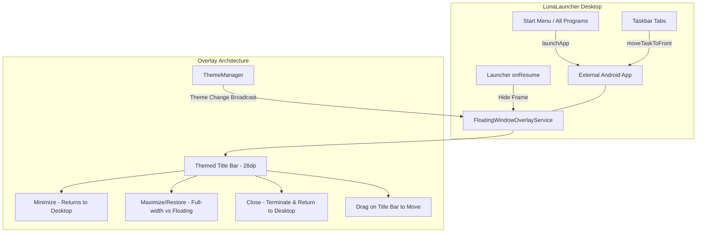

# Universal Windows Frame for Android Applications Specification

**Date:** 2026-10-11  
**Target Platform:** Samsung Galaxy Tab 3 7.0 (`SM-T210`), Android 4.4.2 KitKat (API 19), 1024x600 resolution  
**Project:** Windows XP ROM Project (LunaLauncher)

---

## 1. Overview & Goals

The user wants all external Android applications installed on the device (e.g., Space Cadet Pinball, Samsung Browser, Calculator, Clock, Settings, S Voice, and third-party apps) to automatically receive an authentic Windows XP window frame, matching the existing `WindowFrameView` design. 

### Key Requirements:
1. **Windows Frame for Any Android App:** External apps must display an authentic Windows titlebar with the application's actual icon, name, and three standard control buttons (Minimize, Maximize/Restore, Close).
2. **Moveable Window:** In restored/floating mode, users must be able to drag and reposition the window frame across the screen.
3. **Minimize to Taskbar:** Pressing the Minimize button brings the Windows XP desktop to the front where the application sits as an active tab on the taskbar. Clicking that taskbar tab restores the app to the foreground with its frame.
4. **Close Application:** Pressing the Close button dismisses the window frame, terminates the background process, and returns to the desktop.
5. **Theme Engine Consistency:** The titlebar must dynamically adapt to the active theme (Luna Blue, Olive, Silver, Classic, Vista, Windows 7).
6. **Strict Non-Regression:** Do NOT change the existing look, UI, or UX of `WindowFrameView` or any existing desktop applications (Windows Explorer, Windows Media Player, Picture Viewer, Notepad, Paint, Command Prompt, Control Panel, etc.).

---

## 2. Architecture & Components

### Component Details:

### 2.1 `FloatingWindowOverlayService`
- **Window Type:** `WindowManager.LayoutParams.TYPE_SYSTEM_ALERT` with flags `FLAG_NOT_TOUCH_MODAL | FLAG_LAYOUT_IN_SCREEN`.
- **Title Bar:**
  - Height: 28dp (identical to `WindowFrameView`).
  - Background: dynamically loaded from `ThemeManager.getInstance().getTitlebarActiveRes()`.
  - Icon: loaded via `PackageManager.getApplicationIcon(packageName)` (18dp x 18dp).
  - Title Text: loaded via `PackageManager.getApplicationLabel(...)` (12sp bold, white with drop shadow).
  - Control Buttons:
    - Minimize (`btn_min`, 21x21dp): starts `LauncherActivity` with `FLAG_ACTIVITY_REORDER_TO_FRONT`, hides overlay.
    - Maximize/Restore (`btn_max`/`btn_restore`, 21x21dp): toggles between full-width docked bar at top (`y=0, MATCH_PARENT`) and restored floating frame (480x320dp with `window_frame_border`).
    - Close (`btn_close`, 21x21dp): starts `LauncherActivity` with `FLAG_ACTIVITY_REORDER_TO_FRONT`, hides overlay, calls `killBackgroundProcesses(packageName)`.
- **Drag-to-Move:**
  - `titleBarView.setOnTouchListener` tracks `ACTION_DOWN` and `ACTION_MOVE` using `event.getRawX()` and `event.getRawY()`.
  - When in restored mode, updates `params.x` and `params.y` via `windowManager.updateViewLayout` clamped to screen bounds (0..1024, 0..600).
- **Liveness & Polling Loop:**
  - A lightweight 1000ms runnable checks `activityManager.getRunningTasks(1)`.
  - If top task package != `com.windows.xp.launcher`: updates titlebar with current app's title and icon, shows overlay.
  - If top task package == `com.windows.xp.launcher`: hides overlay so desktop remains clean and unobstructed.

### 2.2 `LauncherActivity` Integration
- **`allProgramsList`:**
  - Update "Installed Applications" click handler to call `launchApp(app.packageName)` instead of unmanaged direct `startActivity`.
- **`launchApp(String pkg)`:**
  - Launches intent with `FLAG_ACTIVITY_NEW_TASK`.
  - Dispatches intent to `FloatingWindowOverlayService` with `EXTRA_PACKAGE_NAME` and `EXTRA_APP_LABEL`.
- **Taskbar Integration (`refreshTaskbarTabs`):**
  - External running tasks from `activityManager.getRunningTasks(6)` continue to be rendered with authentic icons and labels on the taskbar.
  - When a taskbar tab is clicked:
    - Calls `activityManager.moveTaskToFront(task.id, ActivityManager.MOVE_TASK_WITH_HOME)`.
    - Dispatches intent to `FloatingWindowOverlayService` to show and focus that app's Windows frame.
- **`onResume`:**
  - Whenever `LauncherActivity` returns to the foreground, sends broadcast `ACTION_CLOSE_OVERLAY` or intent to `FloatingWindowOverlayService` to dismiss the overlay.

---

## 3. Verification & Acceptance Criteria

1. **Compilation:** `build_apk.sh` compiles `LunaLauncher.apk` cleanly with exit code 0.
2. **Installation:** `adb install -r apps/LunaLauncher.apk` reports `Success`.
3. **External App Launch Verification:**
   - Launching an Android app (e.g. Space Cadet Pinball, S Voice, Calculator) from All Programs displays the authentic Windows title bar matching the active theme with app icon, name, and Minimize/Maximize/Close buttons.
4. **Moveable Window Test:**
   - In restored mode, dragging the title bar repositions the window across the screen.
5. **Minimize Test:**
   - Tapping Minimize returns to the desktop and displays the app tab on the taskbar.
   - Tapping the taskbar tab restores the app and re-shows the Windows title bar.
6. **Close Test:**
   - Tapping Close dismisses the overlay, closes the app, and returns to the desktop.
7. **Existing Native Apps:**
   - Windows Explorer, WMP, Picture Viewer, Notepad, Paint, CMD remain 100% intact with zero changes to their look, UI, or UX.
