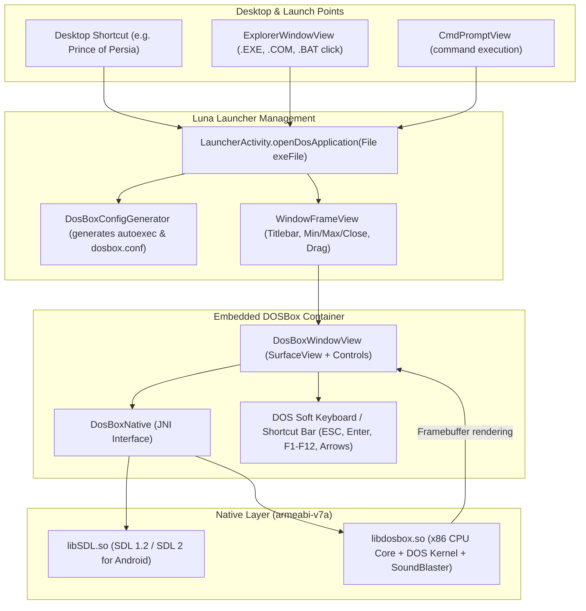

# Embedded DOSBox & Native DOS Application Execution Design

**Status:** Approved  
**Target:** Luna Launcher (`com.windows.xp.launcher`) for Samsung Galaxy Tab 3 7.0 (SM-T210 / SM-T210R | `lt02wifi`)  
**OS Base:** Android 4.4.2 KitKat (API 19, ARMv7-a)

---

## 1. Problem Statement

In classic Windows XP, double-clicking an MS-DOS program (`.EXE`, `.COM`, or `.BAT`) seamlessly launches a windowed MS-DOS prompt or full-screen execution container.

Currently in Luna Launcher:
- `CmdPromptView.java` is a text simulator with Linux shell passthrough. It cannot execute x86 MS-DOS binaries.
- Real 16-bit / 32-bit DOS software (e.g., *Prince of Persia*, *DOOM*, *Commander Keen*, *Turbo C++*) cannot run natively on the ARMv7 Cortex-A9 processor without an x86 PC emulator like DOSBox.
- Users want to double-click a `.EXE` file on the desktop or in Windows Explorer and have it immediately run inside an authentic Windows XP floating window (`WindowFrameView`) on the Luna desktop.

---

## 2. Architecture & Design

### 2.1 Component Architecture



---

## 3. Detailed Component Specifications

### 3.1 Native NDK Libraries (`apps/LunaLauncher/lib/armeabi-v7a/`)
- Target ABI: `armeabi-v7a` with VFPv3-D16 (Marvell PXA986 dual-core Cortex-A9).
- Shared libraries:
  - `libSDL.so`: Handles audio buffering, video surface blitting, and key translation.
  - `libdosbox.so`: Full DOSBox 0.74 core compiled for ARMv7 with dynamic x86 core support.
- Bundling: Included under `apps/LunaLauncher/lib/armeabi-v7a/` and packaged into `LunaLauncher.apk` via `aapt` / `zipalign`.

### 3.2 Dynamic Config Generator (`DosBoxConfigGenerator.java`)
Generates an ephemeral `dosbox.conf` with optimized settings for the Galaxy Tab 3 hardware:
- Sound: SoundBlaster 16 (`sbtype=sb16`, `sbbase=220`, `irq=7`, `dma=1`).
- CPU: `core=dynamic`, `cycles=max` (or fixed 10000-20000 cycles for older 286/386 games).
- Render: `scaler=none` / `normal2x`, `aspect=true`.
- Autoexec pipeline:
  ```ini
  [autoexec]
  mount c /sdcard/DOS
  c:
  cd <GAME_FOLDER>
  <EXECUTABLE_NAME>
  exit
  ```
- Graceful exit: When the user quits the DOS program, DOSBox executes `exit`, triggering a clean shutdown signal back to Java to close the `WindowFrameView`.

### 3.3 DOSBox UI Container (`DosBoxWindowView.java`)
- Extends `RelativeLayout` containing:
  1. **`SurfaceView`**: Renders DOSBox 320x200 / 640x480 video with crisp pixel aspect ratio (4:3) centering.
  2. **Collapsible DOS Utility Overlay**:
     - Quick buttons for keys difficult to access on touchscreens: `[ESC]`, `[ENTER]`, `[SPACE]`, `[TAB]`, `[CTRL]`, `[ALT]`, `[F1]` - `[F10]`, and directional D-pad.
     - Toggle button to show/hide the virtual keyboard overlay.
  3. **Touch-to-Mouse Emulation**:
     - Tap = Left Click.
     - Long Press = Right Click.
     - Drag = Mouse Move.

### 3.4 Integration Points

1. **`ExplorerWindowView.java`**:
   - Detects file extensions: `.EXE`, `.COM`, `.BAT`.
   - On item click: dispatches `onOpenDosExecutable(File file)` callback.

2. **`CmdPromptView.java`**:
   - When entering a command that matches a `.EXE`, `.COM`, or `.BAT` in the current directory or `C:\DOS\`, automatically launches DOSBox with that target.

3. **Desktop Shortcuts**:
   - Desktop icons for bundled classics (e.g. `Prince of Persia`, `DOOM`, `Wolfenstein 3D`) pointing directly to `/sdcard/DOS/<APP>/<APP>.EXE`.
   - Clicking immediately spawns the floating `WindowFrameView`.

---

## 4. Performance & Memory Budget

- **RAM Budget**: The Tab 3 has 1GB total RAM (~500MB available for userspace).
- DOSBox configured with `memsize=16` (16MB DOS RAM), consuming ~35-45MB native memory during active execution.
- Fast startup: Pre-parsed config template loaded into RAM in `< 250ms`.
